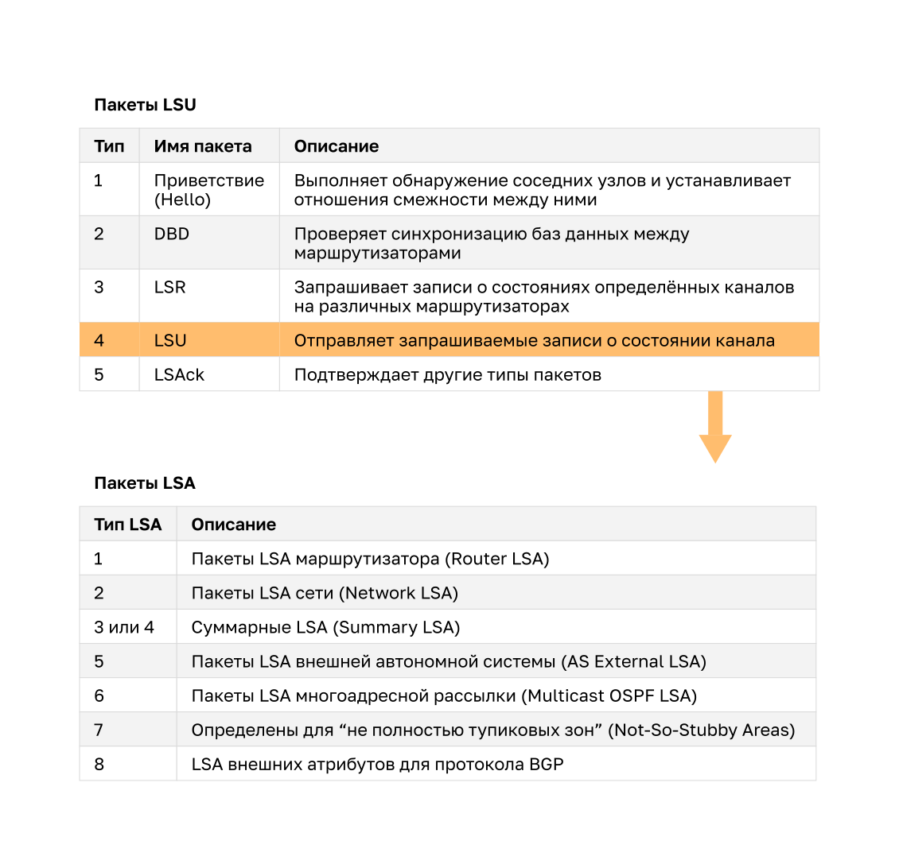
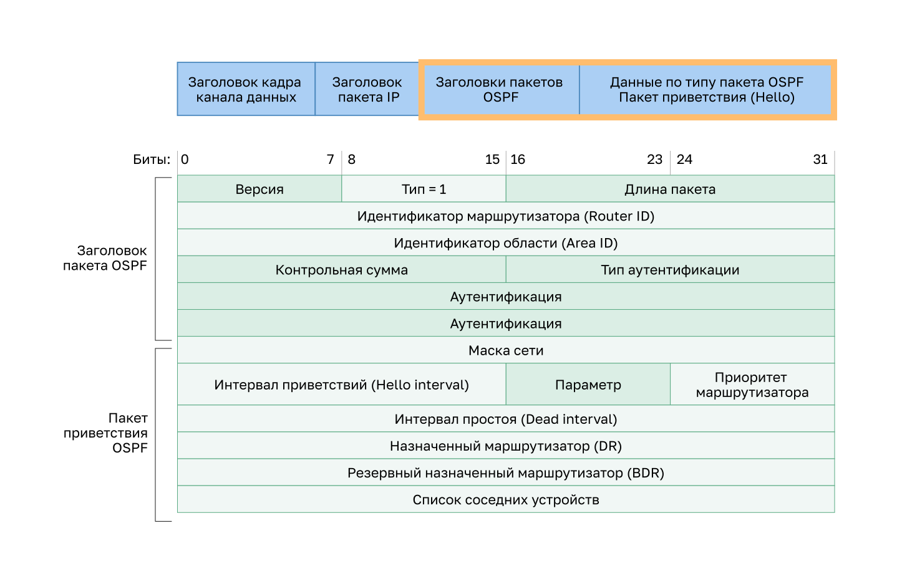

<!-- 1.2.1 -->

<!-- 1.2.2 -->
## Типы пакетов OSPF

**Пакеты состояния канала** — это инструменты, используемые OSPF для определения наиболее быстрого доступного маршрута для пакета. Протокол OSPF использует пакеты состояния канала для установления и поддержания отношений смежности и обмена обновлениями маршрутизации. Каждый тип пакета выполняет определённую задачу в процессе маршрутизации OSPF.

* **Тип 1: пакет приветствия (hello)** — используется для установления и поддержания отношений смежности с маршрутизаторами OSPF.
* **Тип 2: пакет описания базы данных (DBD)** — содержит сокращенный список базы данных состояний каналов отправляющего маршрутизатора. Используется принимающими маршрутизаторами для сверки с локальной базой данных о состоянии канала. Для построения точного дерева кратчайших путей SPF маршрутизаторы с маршрутизацией по состоянию канала в пределах области должны использовать идентичную базу данных состояний каналов.
* **Тип 3: пакет запроса состояния канала (LSR)** — принимающие маршрутизаторы могут запросить дополнительные данные о любой записи в DBD, отправив LSR.
* **Тип 4: пакет обновления состояния канала (LSU)** — используется для отправки отклика на LSR и объявления новых данных; может содержать 11 различных типов LSA.
* **Тип 5: пакет подтверждения состояния канала (LSAck)** — при получении LSU маршрутизатор отправляет LSAck для подтверждения приёма LSU. Пакет LSAck содержит заголовки подтверждаемых LSA.

В таблице показаны пять типов пакетов OSPF, используемых в OSPFv2. OSPFv3 использует аналогичные типы пакетов.

| **Тип** | **Имя пакета** | **Описание** |
| --- | --- | --- |
| 1 | Приветствие | Выполняет обнаружение соседних узлов и устанавливает отношения смежности между ними |
| 2 | Дескриптор базы данных (DBD) | Проверяет синхронизацию баз данных между маршрутизаторами |
| 3 | Запрос состояния канала (LSR) | Запрашивает записи о состояниях определённых каналов на различных маршрутизаторах |
| 4 | Обновление состояния канала (LSU) | Отправляет запрашиваемые записи о состоянии канала |
| 5 | Подтверждение состояния канала (LSAck) | Подтверждает получение LSU |

<!-- 1.2.3 -->
## Обновления состояния канала

Маршрутизаторы первоначально обмениваются пакетами типа 2 DBD, которые представляют собой сокращенный список LSDB отправляющего маршрутизатора. Он используется принимающими для сравнения с локальным LSDB.

LSR (пакет типа 3) используется принимающими маршрутизаторами для запроса дополнительных данных о записи в пакете DBD.

LSU (пакет типа 4) используется для отправки отклика на полученный пакет LSR.

LSAck (пакет типа 5) используется для подтверждения получения LSU типа 4.

Пакеты LSU также используются для пересылки обновлений маршрутизации OSPF, например данных об изменении канала. LSU может содержать 11 различных типов объявлений состояния канала (LSA) протокола OSPFv2: тип 1 — LSA маршрутизатора (Router LSA), тип 2 — LSA сети (Network LSA), типы 3 и 4 — суммарные LSA (Summary LSA), тип 5 — внешние LSA автономной системы (AS External LSA), тип 6 — LSA многоадресной рассылки (Multicast OSPF LSA), тип 7 — LSA не полностью тупиковых областей (Not-So-Stubby Area, NSSA), тип 8 — LSA внешних атрибутов для протокола BGP, типы 9, 10 и 11 — непрозрачные LSA (Opaque LSA). В OSPFv3 некоторые из этих LSA переименованы и добавлены два новых типа LSA: LSA канала (Link LSA) и LSA префиксов внутри области (Intra-Area Prefix LSA).

**Примечание.** Разница между «LSU» и «LSA» не всегда очевидна, поскольку они нередко заменяют друг друга. Однако пакет LSU содержит одно или несколько объявлений LSA.

**Пакеты LSU содержат пакеты LSA**

<!-- /courses/ensa-dl/ae8cded0-34fd-11eb-ba19-f1886492e0e4/aeb30470-34fd-11eb-ba19-f1886492e0e4/assets/c5809c10-1c46-11ea-af56-e368b99e9723.svg -->

* Пакет LSU может содержать одно или несколько объявлений LSA.
* Объявления LSA содержат сведения о маршрутах к сетям назначения.

<!--
показывает, что OSPFv2 LSU может содержать один или несколько различных типов LSAs
-->

<!-- 1.2.4 -->
## Пакет приветствия

**Пакет протокола OSPF типа 1** — это пакет приветствия или hello-пакет, использующийся для выполнения следующих действий:

* обнаружение соседних устройств OSPF и установление отношений смежности с ними;
* объявление параметров, которые должны совпасть у двух маршрутизаторов, чтобы они установили отношения смежности;
* выбор назначенного маршрутизатора (DR) и резервного назначенного маршрутизатора (BDR) в сетях со множественным доступом (Ethernet и Frame Relay). Для каналов типа «точка-точка» наличие DR или BDR не требуется.

Пакет приветствия OSPFv2 начинается с общего заголовка пакета OSPF. Поля заголовка: версия, тип (1 у пакета приветствия), длина пакета, идентификатор маршрутизатора (Router ID), идентификатор области (Area ID), контрольная сумма, тип аутентификации и данные аутентификации. **Идентификатор маршрутизатора** — 32-битное значение, которое однозначно определяет маршрутизатор, отправивший пакет. За заголовком следуют поля самого пакета приветствия: маска подсети интерфейса-отправителя, интервал приветствия (Hello interval), параметры, приоритет маршрутизатора, интервал простоя (Dead interval), адреса назначенного маршрутизатора (DR) и резервного назначенного маршрутизатора (BDR) и список соседних устройств — идентификаторы маршрутизаторов, от которых недавно получены пакеты приветствия.

**Содержимое пакета приветствия OSPF**

<!-- /courses/ensa-dl/ae8cded0-34fd-11eb-ba19-f1886492e0e4/aeb30470-34fd-11eb-ba19-f1886492e0e4/assets/c5815f61-1c46-11ea-af56-e368b99e9723.svg -->

<!--
показывает диаграмму содержимой/полей пакета «Hello» OSPFv2
-->

<!-- 1.2.5 -->
<!-- quiz -->

