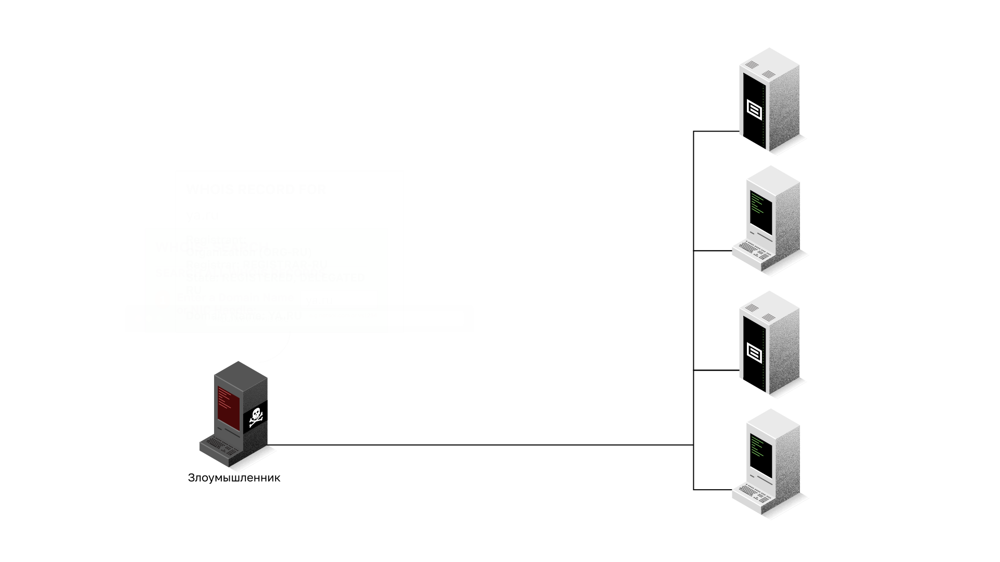
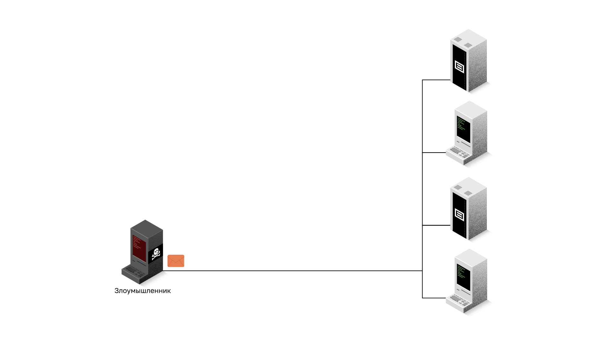
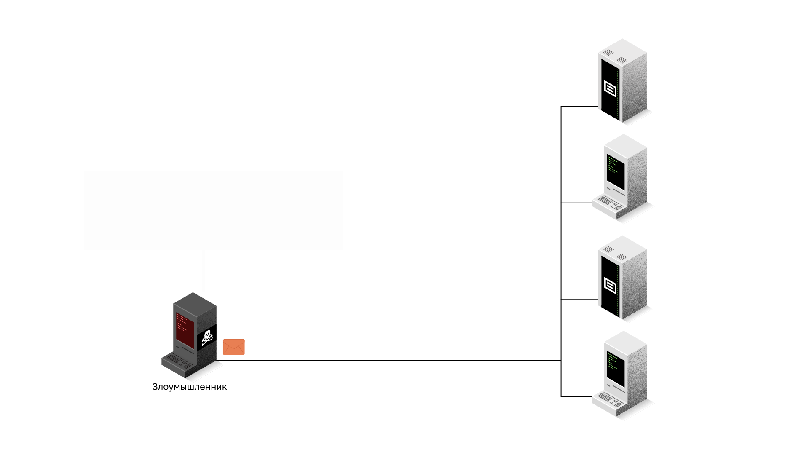
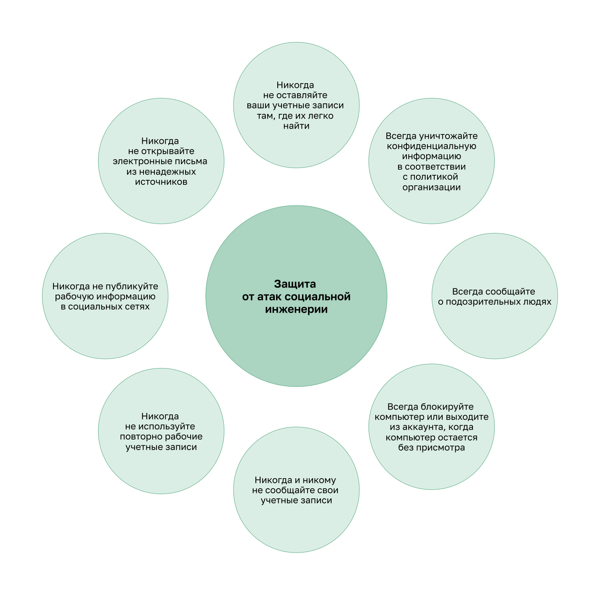

<!-- 3.5.1 -->
## Обзор сетевых атак

Как вы уже знаете, существует много типов вредоносных программ, которые могут использовать злоумышленники. Но это не единственный способ, которым они могут атаковать сеть или даже организацию.

Когда вредоносное ПО доставляется и устанавливается, его информационное наполнение может использоваться для различных сетевых атак.

Для того чтобы минимизировать последствия атак, полезно сначала классифицировать их различные виды, распределив сетевые атаки по категориям.

Сети подвержены следующим типам атак:

* разведывательные атаки;
* атаки доступа;
* атаки типа «отказ в обслуживании» (DoS-атаки).

<!-- 3.5.2 -->
Разведка показывает, что видно о сети снаружи; лишнее закрывают входящим списком на границе.

1. Топология: сеть **192.168.1.0/24** — компьютер **PC-A** и веб-сервер **SRV** — за пограничным маршрутизатором **R1**; снаружи провайдер и внешний компьютер **PC-X**.
2. Обычное состояние. С PC-A команда **ping -n 2 198.51.100.10** достает до внешнего PC-X: связь наружу работает.
3. Проверка снаружи, с PC-X. **ping** по адресам сети: отвечают R1 и оба узла внутри — по ответам на эхо-запросы видно, какие адреса заняты. **telnet 192.168.1.20 80** открывает веб-сервер SRV, а порт **22** отвечает отказом — узел есть, служба закрыта.
4. Защита на R1. Входящий список **access-list 110** разрешает только ответы на наши запросы, сообщения о недоступности и обращения к веб-серверу SRV; его применяют на интерфейсе к провайдеру G0/0/0 на вход — **ip access-group 110 in**. Остальное отбрасывает неявный deny.
5. Та же проверка с PC-X. Эхо-запросы снаружи отброшены: R1 отвечает **Destination host unreachable**, адреса внутри больше не видны. Веб-сервер по-прежнему доступен, порт 22 теперь отфильтрован. Изнутри с PC-A связь наружу работает. На R1 **show access-lists** показывает счетчики: эхо-запросы отброшены, обращения к веб-серверу и ответы на запросы PC-A пропущены.
6. Итог: входящий список на G0/0/0 к провайдеру — эхо-запросы снаружи отброшены, открыт только опубликованный веб-сервер, ответы на наши запросы проходят. Проверка — **ping** и **telnet** с PC-X, **show access-lists**.

<!-- 3.5.3 -->
## Разведывательные атаки

Разведкой называется сбор информации. Такие атаки аналогичны вору, который осматривает окрестности, переходя от двери к двери и притворяясь, будто что-то продает. Вор фактически ищет уязвимые дома для взлома: незанятые дома, дома с легко открывающимися окнами и дверями и дома без систем безопасности или камер видеонаблюдения.

Злоумышленники используют разведывательные атаки для несанкционированного обнаружения и сопоставления систем, служб или уязвимостей. Разведывательные атаки предшествуют атакам доступа или DoS-атакам.

Некоторые техники, используемые злоумышленниками для проведения разведывательных атак, описаны в таблице.

| **Техника** | **Описание** |
| --- | --- |
| **Информационный запрос цели** | хакер ищет исходную информацию о целевом объекте, используя различные инструменты, в том числе поиск Google, веб-сайт организаций, whois и многое другое |
| **Пинг-запрос целевой сети**  | информационный запрос обычно выявляет целевой сетевой адрес. Злоумышленник теперь может инициировать проверку связи, чтобы определить, какие IP-адреса активны |
| **Сканирование портов активных IP-адресов** | используется для определения доступных портов или сервисов. Примеры сканеров портов: инструменты Nmap, SuperScan, Angry IP Scanner и NetScan |
| **Запуск сканеров уязвимостей** | выполняется для опроса идентифицированных портов, определения типа и версии приложений и операционной системы, запущенной на целевом узле. Среди этих инструментов ― Nipper, Secunia PSI, Core Impact, Nessus v6, SAINT, и Open VAS |
| **Запуск эксплойтов** | теперь хакер пытается обнаружить уязвимые сервисы, которые можно использовать. Существует целый ряд инструментов для использования уязвимостей, среди них: Metasploit, Core Impact, Sqlmap, Social Engineer Toolkit и Netsparker |

**Информационные веб-запросы**

Например, злоумышленник открывает сайт службы whois и запрашивает регистрационную запись домена цели. В записи WHOIS указаны владелец домена (регистрант), его почтовый адрес и имя домена: это исходная информация для дальнейшей разведки.

**Выполнение ping-тестирования адресов (Ping Sweep)**

При пинг-тестировании злоумышленник по очереди отправляет эхо-запросы ping (ICMP) на адреса целевой сети. Узлы, которые отвечают эхо-ответами, и есть активные IP-адреса.

**Выполнение сканирования портов**

При сканировании портов злоумышленник, например программой Nmap, отправляет запросы на разные порты каждого активного IP-адреса и по ответам определяет, какие порты открыты и какие сервисы на них работают. В примере ответ приходит от одного из серверов цели.

<!-- 3.5.4 -->
Защита доступа к устройству по SSH — это требование к длине пароля и блокировка после нескольких неудачных входов.

1. Топология: **R1** — пограничный маршрутизатор; администратор управляет им с **PC-A** по SSH под учетной записью admin.
2. Обычное состояние. С PC-A команда **ssh -l admin 192.168.1.1**: после правильного пароля — приглашение R1.
3. Проверка. Три неверных пароля только закрывают сессию, а следующая попытка **ssh -l admin 192.168.1.1** сразу принимается: перебирать пароли можно без остановки.
4. Защита на R1. **security passwords min-length 10** — пароли короче 10 символов больше не принимаются. **login block-for 30 attempts 3 within 60** — три неудачных входа за 60 с закрывают вход на 30 с. На линиях vty оставляют только SSH (**transport input ssh**), вход по локальной учетной записи (**login local**) и тайм-аут простоя (**exec-timeout**).
5. Та же проверка с PC-A. Три неверных пароля — и следующая попытка отклонена: R1 перешел в режим ожидания, в журнале **QUIET_MODE_ON** (вход закрыт после неудач с адреса 192.168.1.10). Через 30 с — **QUIET_MODE_OFF**, и правильный пароль снова открывает вход. Никакие настройки не помогут, если пароль назовут сами, — пароль не сообщают никому.
6. Итог: пароли — не короче 10 символов; вход на vty — только SSH, с локальной учетной записью и тайм-аутом; после трех неудач за 60 с — блокировка на 30 с. Проверка: неверные пароли — отказ, через 30 с — вход.

Социальная инженерия — отдельный разбор ниже; настройки устройства ее не закрывают.

<!-- 3.5.5 -->
## Атаки доступа

Атаки доступа используют известные уязвимости в службах аутентификации, FTP- и веб-сервисах. Цель таких атак – получить доступ к учетным записям в Интернете, конфиденциальным базам данных и другой секретной информации.

Злоумышленники используют атаки доступа на сетевые устройства и компьютеры для получения данных, получения доступа или для расширения прав доступа до статуса администратора.

**Подбор пароля**

При атаке с подбором пароля злоумышленник пытается обнаружить критические системные пароли, используя различные методы. Такие атаки очень распространены и могут быть запущены с использованием различных инструментов взлома паролей.

**Спуфинг-атаки**

В ходе спуфинг-атаки устройство злоумышленника пытается выдать себя за другое путем фальсификации данных. Обычные спуфинговые атаки включают IP-спуфинг, MAC-спуфинг и DHCP-спуфинг. Такие спуфинговые атаки будут более подробно обсуждаться в этом модуле.

Другие атаки доступа включают в себя:

* злоупотребление доверием;
* переадресация портов;
* атака через посредника;
* атака с переполнением буфера.

**Пример злоупотребления доверием**

При атаке со злоупотреблением доверием злоумышленник использует несанкционированные привилегии для получения доступа к системе, что может поставить под угрозу цель. Например, цель злоумышленника — система A, которая доверяет системе B, а система B доверяет всем. Получить доступ к системе A напрямую злоумышленник не может, поэтому идет в обход: из Интернета подключается к системе B как пользователь sivanov (Сергей Иванов) и компрометирует ее. Теперь он управляет системой B, а через доверие системы A к системе B получает доступ и к системе A.

**Пример переадресации портов**

При атаке с переадресацией портов злоумышленник использует взломанную систему в качестве базы для атак на другие целевые объекты. Например, злоумышленник подключается по протоколу SSH (порт 22) к скомпрометированному узлу A. Узел B доверяет узлу A, поэтому злоумышленник через узел A подключается к узлу B по протоколу Telnet (порт 23).

<!-- /courses/ensa-dl/ae8e8c80-34fd-11eb-ba19-f1886492e0e4/aeb3eed2-34fd-11eb-ba19-f1886492e0e4/assets/c5daa2f4-1c46-11ea-af56-e368b99e9723.svg -->

**Пример атаки с посредником**

При атаке через посредника злоумышленник располагается между двумя доверяемыми объектами, чтобы читать, изменять или перенаправлять данные, которыми они обмениваются. Например, жертва запрашивает веб-страницу, но ее запрос через коммутатор S5 и маршрутизаторы R1 и R2 попадает на компьютер злоумышленника. Злоумышленник получает запрошенную страницу с настоящего веб-сервера, может изменить ее и пересылает жертве.

<!-- /courses/ensa-dl/ae8e8c80-34fd-11eb-ba19-f1886492e0e4/aeb3eed2-34fd-11eb-ba19-f1886492e0e4/assets/c5daf113-1c46-11ea-af56-e368b99e9723.svg -->

**Атака с переполнением буфера**

При атаке с переполнением буфера злоумышленник передает программе на целевом узле входные данные, которые не помещаются в выделенный для них буфер памяти, и программа записывает их за пределы буфера. Часто это делает систему неработоспособной, то есть создает атаку DoS, а специально подобранные данные могут даже выполнить код злоумышленника. Например, злоумышленник отправляет серверу-жертве через маршрутизаторы R2 и R1 и коммутатор S5 пакеты с такими данными.

<!-- /courses/ensa-dl/ae8e8c80-34fd-11eb-ba19-f1886492e0e4/aeb3eed2-34fd-11eb-ba19-f1886492e0e4/assets/c5db3f31-1c46-11ea-af56-e368b99e9723.svg -->

<!-- 3.5.6 -->
## Атаки методами социальной инженерии

Социальная инженерия – это атака, которая пытается заставить человека выполнить определенные действия или раскрыть конфиденциальную информацию. Некоторые методы социальной инженерии подразумевают личное обращение к человеку, в то время как другие действуют через телефон или интернет.

Социальные инженеры часто полагаются на готовность людей помочь, используют человеческие слабости. Например, злоумышленник может обратиться к уполномоченному сотруднику с неотложной проблемой, при которой требуется немедленный сетевой доступ. Злоумышленник может сыграть на тщеславии или жадности сотрудника или сослаться на известный авторитет.

Информация о методах социальной инженерии приведена в таблице.

| **Методы социальной инженерии** | **Описание** |
| --- | --- |
| **Вымышленный предлог** | злоумышленник притворяется, что ему необходимы личные или финансовые данные для подтверждения подлинности получателя |
| **Фишинг** | хакер рассылает отдельным пользователям по электронной почте сообщение, которое замаскировано как письмо из законного надежного источника, рассчитывая, что пользователь нажмет ссылку, загрузит вредоносное ПО или откроет личную или финансовую информацию |
| **Направленный фишинг** | киберпреступник создает направленную фишинговую атаку, предназначенную для конкретного человека или организации |
| **Нежелательная почта** | злоумышленники могут отправлять спам по электронной почте, чтобы заставить пользователя щелкнуть на зараженную ссылку или загрузить зараженный файл |
| **Услуга за услугу (взаимовыгодный обмен)** | иногда называется **Quid pro quo**. Киберпреступник просит предоставить ему персональные данные какой-либо стороны в обмен на что-то, например безвозмездный дар |
| **Приманка** | злоумышленник оставляет зараженное вредоносным ПО физическое устройство, например, USB-накопитель, в общедоступном месте. Нашедший устройство может вставить его в свой компьютер и нечаянно установить вредоносное ПО |
| **Выдача себя за другое лицо** | хакер притворяется тем, кем он не является, чтобы завоевать доверие жертвы |
| **Несанкционированное проникновение** | субъект угрозы быстро следует за авторизованным лицом в закрытое место, чтобы получить доступ к защищенной зоне |
| **Визуальное хакерство (взгляд через плечо)** | киберпреступник физически следит за жертвой, «смотрит через плечо», при вводе учетных данных, пароля и другой информации |
| **Исследование содержимого мусорных корзин** | злоумышленник роется в мусорных корзинах, чтобы найти конфиденциальные документы |

Компанией TrustedSec был разработан набор инструментов социальной инженерии (Social Engineering Toolkit, SET), чтобы помочь «белым» хакерам и другим специалистам по сетевой безопасности организовывать атаки методами социальной инженерии для проверки своих собственных сетей.

Предприятия должны информировать своих пользователей о рисках социальной инженерии и разрабатывать стратегии для подтверждения личности по телефону, электронной почте или лично.

Все пользователи должны следовать рекомендуемым методам защиты от атак социальной инженерии: никогда и никому не сообщать свои учетные данные, не оставлять их там, где их легко найти, не использовать повторно рабочие учетные записи, не открывать электронные письма из ненадежных источников и не публиковать рабочую информацию в социальных сетях; всегда уничтожать конфиденциальную информацию в соответствии с политикой организации, сообщать о подозрительных людях и блокировать компьютер или выходить из учетной записи, когда компьютер остается без присмотра.

**Рекомендуемые методы защиты с помощью социальной инженерии**

<!-- /courses/ensa-dl/ae8e8c80-34fd-11eb-ba19-f1886492e0e4/aeb3eed2-34fd-11eb-ba19-f1886492e0e4/assets/c5dbb462-1c46-11ea-af56-e368b99e9723.svg -->

<!-- 3.5.7 
## Исследовательская работа: Социальная инженерия

В этой лабораторной работе вы изучите методы социальной инженерии, а также способы, которые помогут распознать и предотвратить ее.

[Социальная инженерия (lab)](./assets/3.5.7-lab---social-engineering_ru-RU.pdf) -->

<!-- 3.5.8 -->

<!-- 3.5.9 -->
## DoS- и DDoS-атаки

DoS-атака («отказ в обслуживании») влечет за собой перебои в сетевых службах для пользователей, устройств или приложений. Существует два типа DoS-атак.

* **Огромные объемы трафика** – киберпреступник отправляет огромное количество данных с такой скоростью, что сеть, узел или приложение не успевает их обрабатывать. Это приводит к замедлению передачи и времени отклика. А также может привести к сбою работы устройства или службы.
* **Пакеты с неправильным форматированием** – хакер посылает пакет данных с неправильным форматированием на узел или в приложение. Это замедляет его работу или приводит к сбою.

**DoS-атака**

DoS-атаки представляют высокий риск, поскольку могут легко нарушить обмен информацией и привести к крупным потерям времени и средств. Проводить такие атаки относительно несложно, это под силу даже неопытным злоумышленникам.

Например, злоумышленник непрерывно отправляет веб-серверу банка через Интернет эхо-запросы ping, чтобы сервер не мог обрабатывать никакие другие обращения. Сервер перегружен, а пользователи замечают, что сайт работает очень медленно.

**Распределенная атака DDoS**

Распределенные атаки типа «отказ в обслуживании» (DDoS) похожи на DoS-атаки, но проводятся скоординировано из нескольких источников. Например, злоумышленник создает сеть зараженных узлов, известных как зомби. Злоумышленник использует систему командования и управления (CnC) для отправки контрольных сообщений зомби, которые постоянно сканируют и заражают все больше узлов вредоносным кодом – ботами. Вредоносная программа бота предназначена для заражения узла, превращая его в зомби, который может связываться с системой CnC. Группа зомби, инфицированных самостоятельно распространяющимся ботами, называется ботнет. Когда все готово, злоумышленник через систему управления отдает приказ начать DDoS-атаку.

Например, злоумышленник заражает несколько компьютеров и присоединяет их к своему ботнету, а затем отдает команду начать DDoS-атаку. На зараженных компьютерах (зомби) активируется код атаки, и они одновременно отправляют трафик веб-серверу банка. Сервер получает слишком много трафика и перестает обслуживать пользователей.

<!-- 3.5.10 -->
<!-- quiz -->

