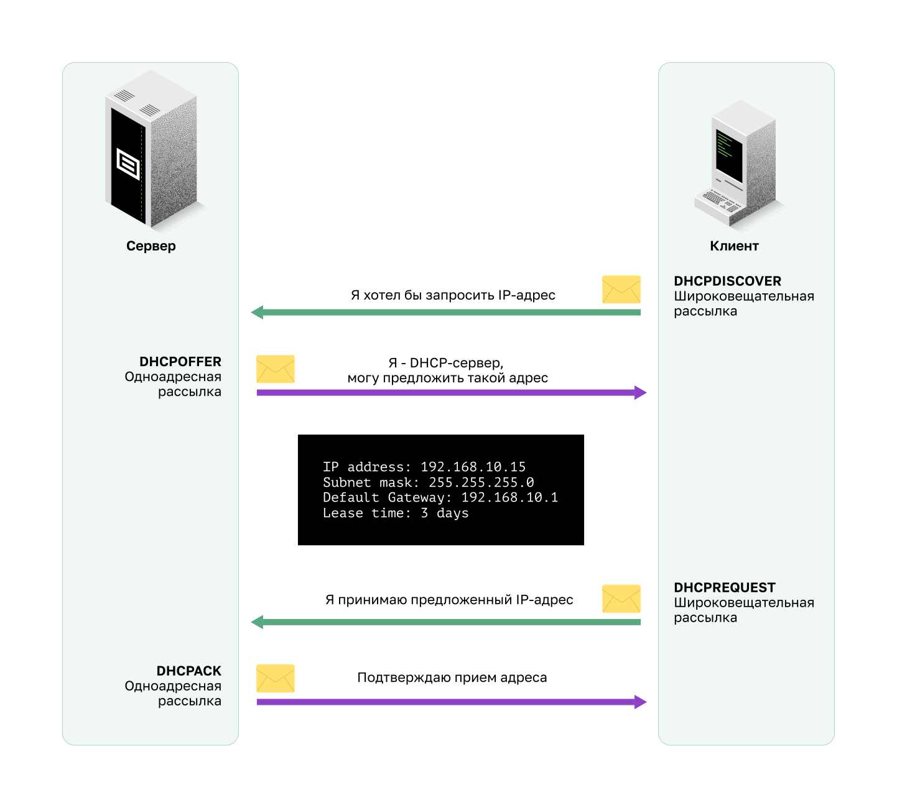

<!-- 3.8.1 -->
## Уязвимости ARP

Ранее в этом модуле мы рассматривали уязвимости, связанные с IP, TCP и UDP. Стек протоколов TCP/IP никогда не создавался для безопасности. Поэтому службы, которые IP использует для адресации, такие как ARP, DNS и DHCP, также не являются безопасными, как вы узнает далее.

Узлы передают ARP-запрос в широковещательном режиме другим узлам в сегменте, чтобы определить MAC-адрес узла с конкретным IP-адресом. Все узлы в подсети получают и обрабатывают этот ARP-запрос. Узел с IP-адресом, соответствующим ARP-запросу, отправляет ARP-ответ.

Например, узел H1 (192.168.1.5) должен узнать MAC-адрес узла H4 (192.168.1.7) и отправляет широковещательный ARP-запрос. Коммутатор доставляет его узлам H2 (192.168.1.6), H3 (192.168.1.8) и H4. Узлы H2 и H3 видят, что запрос относится не к ним, и не отвечают, а H4 отправляет узлу H1 ARP-ответ со своим MAC-адресом. Теперь H1 знает MAC-адрес H4 и может отправить ему IP-пакет.

**Процесс ARP**

Любой клиент может отправить незапрашиваемый ARP-ответ, который называется gratuitous ARP (самообращенный ARP). Обычно это происходит при первой загрузке устройства для передачи всем остальным устройствам в локальной сети MAC-адреса нового устройства. Когда узел отправляет самообращенный ARP, другие узлы в подсети сохраняют в своих ARP-таблицах содержащиеся в нем MAC-адрес и IP-адрес.

Эта функция ARP также означает, что любой узел может объявить себя владельцем любого выбранного IP или MAC-адреса. Злоумышленник может подделать записи кеша ARP-устройств в локальной сети, организуя атаку через посредника для перенаправления трафика, с целью заставить атакуемый узел изменить свой шлюз по умолчанию на устройство хакера. Таким образом, киберпреступник размещается между жертвой и другими системами, находящимися за пределами локальной подсети.

<!-- 3.8.2 -->
## Подделка записей кеша ARP

Подделка записей кеша ARP может использоваться для запуска различных атак «через посредника».

**ARP-запрос**

Например, в одной сети находятся компьютер PC-A (IP-адрес 192.168.10.10, MAC-адрес AA:AA:AA:AA:AA:AA), его шлюз по умолчанию — маршрутизатор R1 (192.168.10.1, A1:A1:A1:A1:A1:A1) — и узел злоумышленника (192.168.10.254, EE:EE:EE:EE:EE:EE). Компьютер PC-A запрашивает MAC-адрес своего шлюза по умолчанию, отправляя ARP-запрос на получение MAC-адреса для IP-адреса 192.168.10.1.

<!-- /courses/ensa-dl/ae8e8c80-34fd-11eb-ba19-f1886492e0e4/aeb3eed8-34fd-11eb-ba19-f1886492e0e4/assets/c5e9e532-1c46-11ea-af56-e368b99e9723.svg -->

**ARP-ответ**

Маршрутизатор R1 вносит в свой кэш ARP IP- и MAC-адреса компьютера PC-A (192.168.10.10 и AA:AA:AA:AA:AA:AA) и отправляет компьютеру PC-A ARP-ответ: адресу 192.168.10.1 соответствует MAC-адрес A1:A1:A1:A1:A1:A1. Компьютер PC-A вносит эту пару адресов в свой кэш ARP.

<!-- /courses/ensa-dl/ae8e8c80-34fd-11eb-ba19-f1886492e0e4/aeb3eed8-34fd-11eb-ba19-f1886492e0e4/assets/c5ea3352-1c46-11ea-af56-e368b99e9723.svg -->

**Поддельные ARP-ответы**

Затем злоумышленник отправляет два поддельных незапрошенных ARP-ответа со своим MAC-адресом EE:EE:EE:EE:EE:EE: компьютеру PC-A — что этот MAC-адрес имеет 192.168.10.1, а маршрутизатору R1 — что его имеет 192.168.10.10. Компьютер PC-A обновляет сведения о шлюзе по умолчанию в своем кэше ARP, которые теперь указывают на MAC-адрес узла злоумышленника. Маршрутизатор R1 также обновляет свой кэш ARP, внося в него IP-адрес компьютера PC-A, указывающий на MAC-адрес злоумышленника.

Теперь узел киберпреступника проводит атаку с подделкой записей кеша ARP. Они могут быть пассивными или активными. Пассивные – хакеры крадут конфиденциальную информацию. Активные – они изменяют передаваемые данные или внедряют вредоносные данные.

<!-- /courses/ensa-dl/ae8e8c80-34fd-11eb-ba19-f1886492e0e4/aeb3eed8-34fd-11eb-ba19-f1886492e0e4/assets/c5ea8170-1c46-11ea-af56-e368b99e9723.svg -->

**Примечание.** В Интернете доступно множество инструментов для организации атак «через посредника» с использованием ARP, включая dsniff, Cain & Abel, ettercap, Yersinia и другие.

<!-- 3.8.3 -->
## Видео: Спуфинг ARP

Просмотрите видео «Спуфинг ARP».

<!-- 3.8.4 -->
## Атаки DNS

Протокол системы доменных имен (Domain Name Service, DNS) определяет автоматизированную службу, которая сопоставляет имена ресурсов с соответствующими числовыми сетевыми адресами, такими как IPv4 или IPv6. Он включает в себя формат для запросов, ответов и самих данных и использует записи ресурсов (RR), чтобы определить тип DNS-ответа.

Обеспечением безопасности DNS часто пренебрегают. Однако этот протокол имеет решающее значение для работы сети и должен быть соответствующим образом защищен.

DNS-атаки включают в себя:

* открытые преобразователи имен DNS;
* скрытые атаки DNS;
* атаки с теневыми поддоменами (domain shadowing);
* атаки туннелирования DNS.

**Открытые преобразователи имен DNS**

Для предоставления ответов на запросы во многих организациях используются сервисы общедоступных открытых DNS-серверов, например Яндекс DNS (77.88.8.8). DNS-сервер такого типа называется открытым преобразователем имен. Он отвечает на запросы клиентов, находящихся за пределами его административного домена. Открытые преобразователи имен DNS уязвимы для различных вредоносных действий, включая следующие.

| **Уязвимости преобразователей DNS** | **Описание** |
| --- | --- |
| **Подделка записей кеша DNS** | злоумышленники отправляют поддельную информацию записей ресурсов (RR) в преобразователь имен DNS, чтобы перенаправить пользователей с законных на вредоносные сайты. DNS атаки с подделкой записей кеша DNS могут использоваться, чтобы заставить преобразователь имен DNS использовать вредоносный сервер, который предоставляет информацию о записях ресурсов (RR) для выполнения вредоносных действий |
| **Атаки по методу умножения и отражения на основе DNS** | хакеры при DoS- или DDoS-атаках используют открытые преобразователи имен DNS, чтобы увеличить объем атаки и скрыть ее настоящий источник. Злоумышленники отправляют DNS-сообщения открытым преобразователям имен, используя IP-адрес целевого узла (жертвы). Эти атаки возможны, поскольку открытый преобразователь имен будет отвечать на запросы от любого объекта |
| **Атаки с использованием ресурсов DNS** | DoS-атака, использующая ресурсы открытых преобразователей DNS-имен. Эта DoS-атака потребляет все доступные ресурсы, отрицательно влияя на работу преобразователя имен DNS. В результате может потребоваться перезапуск преобразователя имен DNS или остановка и перезапуск служб |

**Скрытые атаки DNS**

Для того чтобы скрыть информацию, по которой их можно определить, хакеры применяют для проведения атак следующие скрытые методы использования DNS.

| **Техники скрытых атак DNS** | **Описание** |
| --- | --- |
| **Метод Fast flux** | используется, чтобы скрыть фишинговые и распространяющие вредоносное ПО сайты, внутри быстро меняющейся сети взломанных DNS узлов. IP-адреса DNS постоянно изменяются в течение считанных минут. Ботнеты часто используют методы Fast Flux, чтобы эффективно скрыть (замаскировать) от обнаружения вредоносные серверы |
| **Метод Double IP Flux** | позволяет быстро изменять сопоставления имен узлов и IP-адресов, а также доверенный сервер имен. В результате повышается сложность определения источника атаки |
| **Алгоритмы создания доменов** | злоумышленники используют этот метод во вредоносном ПО, чтобы случайным образом генерировать доменные имена, которые можно использовать как точки встречи для серверов управления и контроля (C&C) |

**Атаки с теневыми поддоменами (domain shadowing)**

При атаке с теневыми поддоменами хакер взламывает родительский домен и создает несколько поддоменов для использования во время атаки. Эти поддомены указывают на вредоносные серверы без предупреждения фактического владельца родительского домена.

<!-- 3.8.5 -->
## Туннелирование DNS

Хакеры, использующие туннелирование DNS, помещают в трафик DNS не относящийся к DNS трафик. Этот метод позволяет обойти решения по обеспечению безопасности, когда злоумышленник хочет связаться с ботами внутри защищенной сети или отфильтровать данные организации, такие как база паролей. Для использования хакером туннелирования DNS изменяются различные типы записей DNS. Вот как работает туннелирование DNS для команд CnC, отправляемых в ботнет:

1.  данные разбиваются на несколько закодированных фрагментов;
2.  каждый фрагмент помещается в метку доменного имени нижнего уровня в DNS-запросе;
3.  так как ответ локального или сетевого DNS-сервера на этот запрос отсутствует, запрос отправляется на рекурсивные DNS-серверы интернет-провайдера;
4.  рекурсивная служба DNS перенаправляет запрос на доверенный сервер доменных имен злоумышленника;
5.  этот процесс повторяется, пока не будут отправлены все запросы, содержащие фрагменты данных;
6.  когда доверенный сервер доменных имен хакера получает DNS-запросы от зараженных устройств, он отправляет ответ на каждый запрос, содержащий инкапсулированные, зашифрованные команды;
7.  вредоносное ПО, находящееся на скомпрометированном узле, собирает фрагменты данных и выполняет скрытые в них команды.

Для того чтобы иметь возможность остановить туннелирование DNS, необходимо использовать фильтр, который проверяет DNS-трафик. Обратите особое внимание на DNS-запросы, длина которых превышает среднее значение, а также запросы, содержащие подозрительное доменное имя. Кроме того, облачные службы фильтрации DNS блокируют значительную часть трафика туннелирования DNS, выявляя подозрительные домены.

<!-- 3.8.6 -->
## DHCP

Серверы DHCP предоставляют клиентским устройствам сведения о конфигурации динамических IP-адресов. Обычно клиент и сервер обмениваются четырьмя DHCP-сообщениями.

**Нормальная работа DHCP**

<!-- /courses/ensa-dl/ae8e8c80-34fd-11eb-ba19-f1886492e0e4/aeb3eed8-34fd-11eb-ba19-f1886492e0e4/assets/c5ec0813-1c46-11ea-af56-e368b99e9723.svg -->

Клиент отправляет широковещательное сообщение DHCPDISCOVER. Сервер DHCP отвечает одноадресным сообщением DHCPOFFER с предложением параметров, например IP-адреса 192.168.10.15, маски подсети 255.255.255.0, шлюза по умолчанию 192.168.10.1 и срока аренды 3 дня. Клиент широковещательным сообщением DHCPREQUEST сообщает, что принимает предложение, и сервер подтверждает его одноадресным сообщением DHCPACK.

<!-- 3.8.7 -->
## Атаки, связанные с DHCP

**DHCP-спуфинг**

Атака типа «DHCP-спуфинг» состоит в том, что к сети подключается мошеннический DHCP-сервер и предоставляет ложные параметры настройки IP легитимным клиентам. Подставной сервер может предоставлять различные неправильные сведения.

* **Неправильный шлюз по умолчанию** – хакер предоставляет неправильный шлюз или IP-адрес своего узла для создания атаки через посредника. Это может пройти полностью незамеченным, поскольку он перехватывает поток данных в сети.
* **Неправильный DNS-сервер** – злоумышленник предоставляет неправильный адрес DNS-сервера, направляя пользователя на вредоносный веб-сайт.
* **Неправильный IP-адрес** – киберпреступник предоставляет неправильный IP-адрес и/или IP-адрес шлюза по умолчанию. Затем создает DoS-атаку на DHCP-клиента.

Предположим, что субъект угрозы уже успешно подключил мошеннический сервер DHCP к порту коммутатора в той же подсети, в которой находятся целевые клиенты. Цель подставного сервера — предоставить клиентам неправильную информацию о настройке IP.

**1. Клиент делает широковещательную рассылку сообщений об обнаружении DHCP**

Легитимный клиент подключается к сети и запрашивает параметры настройки IP. Для этого он отправляет широковещательное сообщение DHCPDISCOVER, ожидая ответа от DHCP-сервера. Коммутаторы доставляют это сообщение обоим серверам — законному и подставному.

<!-- /courses/ensa-dl/ae8e8c80-34fd-11eb-ba19-f1886492e0e4/aeb3eed8-34fd-11eb-ba19-f1886492e0e4/assets/c5eca453-1c46-11ea-af56-e368b99e9723.svg -->

**2. Сервер DHCP отвечает с предложениями**

Законный и подставной DHCP-серверы отправляют клиенту сообщения DHCPOFFER с параметрами настройки IP, которые выглядят допустимыми. Клиент ответит на первое полученное предложение.

<!-- /courses/ensa-dl/ae8e8c80-34fd-11eb-ba19-f1886492e0e4/aeb3eed8-34fd-11eb-ba19-f1886492e0e4/assets/c5ed1982-1c46-11ea-af56-e368b99e9723.svg -->

**3. Клиент принимает мошенническое предложение DHCP**

В этом сценарии клиент первым получает предложение от подставного сервера. Он отправляет широковещательное сообщение DHCPREQUEST, принимая параметры подставного сервера. Запрос получат и законный, и подставной серверы.

<!-- /courses/ensa-dl/ae8e8c80-34fd-11eb-ba19-f1886492e0e4/aeb3eed8-34fd-11eb-ba19-f1886492e0e4/assets/c5eea020-1c46-11ea-af56-e368b99e9723.svg -->

**4. Мошеннические подтверждения**

Однако подтверждение DHCPACK клиенту отправит одноадресным сообщением только подставной сервер. Законный сервер прекращает общение с клиентом, потому что в сообщении DHCPREQUEST указан идентификатор выбранного сервера — подставного, и законный сервер считает свое предложение отклоненным.

<!-- /courses/ensa-dl/ae8e8c80-34fd-11eb-ba19-f1886492e0e4/aeb3eed8-34fd-11eb-ba19-f1886492e0e4/assets/c5ef3c62-1c46-11ea-af56-e368b99e9723.svg -->

