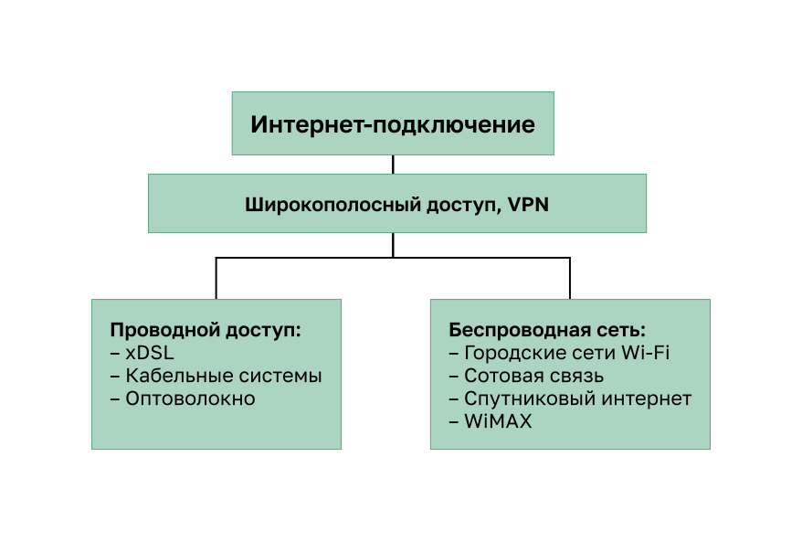
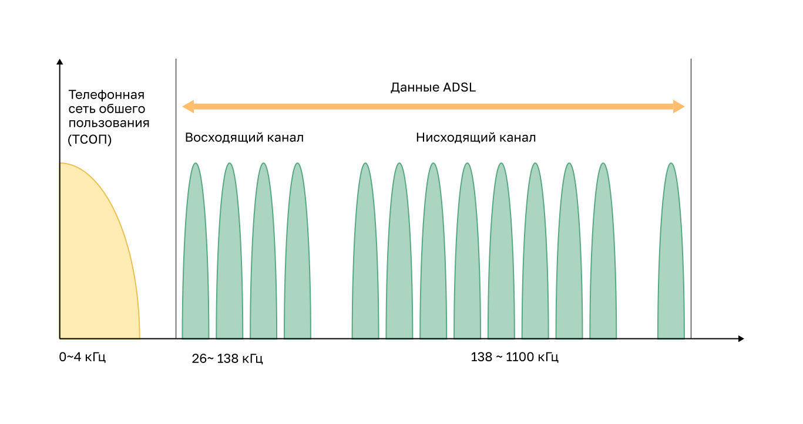

<!-- 7.5.1 -->
## Варианты подключения через Интернет

Современные варианты подключения к глобальной сети не заканчиваются Ethernet WAN и MPLS. Сегодня существует множество сетевых проводных и беспроводных вариантов, из которых можно выбрать. Широкополосное подключение через Интернет является альтернативой использованию выделенных вариантов глобальной сети.

Подключение через Интернет — это широкополосный доступ, часто вместе с VPN. Он бывает проводным (xDSL, кабельные системы, оптоволокно) и беспроводным (городские сети Wi-Fi, сотовая связь, спутниковый интернет, WiMAX).

<!-- /courses/ensa-dl/ae8e8c88-34fd-11eb-ba19-f1886492e0e4/aeb5757c-34fd-11eb-ba19-f1886492e0e4/assets/c65b1d92-1c46-11ea-af56-e368b99e9723.svg -->

Подключения к Интернету можно разделить на проводные и беспроводные.

**Проводные**

Используют постоянный кабель (например, медный или волоконный) для обеспечения согласованной полосы пропускания и снижения частоты ошибок и задержек. Примерами проводного широкополосного подключения являются цифровая абонентская линия (DSL), кабельные соединения и оптоволоконные сети.

**Беспроводные**

Варианты беспроводного подключения менее дорогостоящие по сравнению с другими способами подключения к глобальной сети, поскольку для передачи данных используются радиоволны вместо проводной среды передачи. Однако на беспроводные сигналы могут негативно влиять такие факторы, как расстояние от радиовышки, помехи от других источников, погода и количество пользователей, обращающихся к общему пространству. Примеры беспроводного широкополосного доступа включают услуги сотовой связи 3G/4G/5G или спутникового Интернета. Варианты беспроводной среды передачи зависят от местоположения.

<!-- 7.5.2 -->
## Технология DSL

Технология DSL обеспечивает постоянное соединение, которое использует существующие телефонные линии на основе витой пары для широкополосной передачи данных и предоставляет абонентам IP-сервисов. В настоящее время DSL является популярным решением среди ИТ-подразделений предприятий для поддержки своих сотрудников, работающих на дому.

При использовании технологии ADSL полоса пропускания медного проводника распределяется так: диапазон 0–4 кГц занимает голосовая связь телефонной сети общего пользования (ТСОП), диапазон 26–138 кГц — восходящий канал ADSL, а диапазон 138–1100 кГц — нисходящий канал ADSL.

<!-- /courses/ensa-dl/ae8e8c88-34fd-11eb-ba19-f1886492e0e4/aeb5757c-34fd-11eb-ba19-f1886492e0e4/assets/c65bb9d2-1c46-11ea-af56-e368b99e9723.svg -->

Обе полосы, голосовая и ADSL, лежат в диапазоне частот, который поддерживает одна медная проводная пара, поэтому телефон и DSL могут работать по одной линии одновременно.

Существует несколько разновидностей xDSL, предлагающих различные скорости передачи и загрузки. Однако все формы DSL классифицируются как асимметричный DSL (ADSL) или симметричный DSL (SDSL). ADSL и ADSL2+ обеспечивает более высокую пропускную способность нисходящих каналов, идущих по направлению к пользователю, по сравнению с восходящими каналами. SDSL обеспечивает одинаковую пропускную способность в обоих направлениях.

Скорость передачи данных зависит от фактической длины местной линии, а также от типа и состояния кабелей. Например, для гарантированного качества сигнала контур ADSL должен быть менее 5,46 км (3,39 мили).

Этот процесс сопряжен с рисками безопасности, но их можно снизить с помощью мер безопасности.

<!-- 7.5.3 -->
## Подключения DSL

Операторы связи развертывают DSL-соединения в пределах местной линии. Соединение устанавливается между DSL-модемом и мультиплексором доступа DSL (DSLAM). Например, домашний маршрутизатор абонента подключен к DSL-модему, а модем по телефонной линии — к DSLAM, через который абонент получает доступ в Интернет. По той же телефонной линии работает и телефонная связь ТСОП.

<!-- /courses/ensa-dl/ae8e8c88-34fd-11eb-ba19-f1886492e0e4/aeb5757c-34fd-11eb-ba19-f1886492e0e4/assets/c65c5610-1c46-11ea-af56-e368b99e9723.svg -->

DSL-модем преобразует сигналы Ethernet от устройства клиента в сигнал DSL, который передается мультиплексору доступа DSL (DSLAM) в местоположении поставщика.

DSLAM — это устройство, расположенное в центральном офисе поставщика, собирающее подключения нескольких абонентов DSL. DSLAM часто встраивается в маршрутизатор агрегации.

Преимущество DSL по сравнению с кабельной технологией заключается в том, что DSL не является коллективно используемой средой. Каждый пользователь имеет отдельное прямое подключение к DSLAM. Добавление пользователей не влияет на производительность до тех пор, пока подключение к Интернету DSLAM у интернета-провайдера не достигает предельных значений нагрузки.

<!-- 7.5.4 -->
## DSL и РРР

Протокол «точка-точка» (PPP) — это протокол уровня 2, который обычно используется поставщиками телефонных услуг для установления соединений между маршрутизаторами и между узлом и сетью по сетям удаленного доступа и ISDN.

Интернет-провайдеры по-прежнему используют PPP в качестве протокола уровня 2 для широкополосных DSL-подключений из-за следующих факторов:

* PPP может использоваться для аутентификации подписчика;
* PPP может назначить публичный IPv4 адрес абоненту;
* PPP предоставляет функции управления качеством канала.

DSL-модем имеет интерфейс DSL для подключения к сети DSL и интерфейс Ethernet для подключения к клиентскому устройству. Однако каналы Ethernet изначально не поддерживают PPP.

**Узел с клиентом PPPoE**

Узел запускает клиент PPPoE, чтобы получить публичный IP-адрес от сервера PPPoE на площадке поставщика. Клиентское программное обеспечение PPPoE передает DSL-модему кадры PPP с IP-пакетами внутри кадров Ethernet, а по телефонной линии сеанс PPP продолжается до сервера PPPoE поставщика. В этой топологии подключение может использовать только один клиент. Кроме того, здесь нет маршрутизатора, который защищал бы внутреннюю сеть.

<!-- /courses/ensa-dl/ae8e8c88-34fd-11eb-ba19-f1886492e0e4/aeb5757c-34fd-11eb-ba19-f1886492e0e4/assets/c65cf252-1c46-11ea-af56-e368b99e9723.svg -->

**Маршрутизатор как клиент PPPoE**

Другим решением является настройка маршрутизатора в качестве клиента PPPoE. Маршрутизатор является клиентом PPPoE и получает конфигурацию от поставщика. Он передает DSL-модему кадры Ethernet с PPP и IP-пакетами внутри, а клиенты обмениваются с маршрутизатором обычными кадрами Ethernet с IP-пакетами и не знают о DSL-соединении. В этой топологии несколько клиентов могут совместно использовать DSL-соединение.

<!-- /courses/ensa-dl/ae8e8c88-34fd-11eb-ba19-f1886492e0e4/aeb5757c-34fd-11eb-ba19-f1886492e0e4/assets/c65e2ad1-1c46-11ea-af56-e368b99e9723.svg -->

<!-- 7.5.5 -->
## Кабельная технология

Кабельная технология — технология высокоскоростного постоянного подключения, которая использует коаксиальный кабель от кабельной компании для предоставления IP-услуг пользователям. Как и DSL, кабельная технология является популярным решением для домашних пользователей и ИТ-подразделений предприятий для поддержки сотрудников, работающих на дому.

Современные кабельные системы позволяют реализовать расширенный набор телекоммуникационных услуг, включая высокоскоростной доступ к Интернету, цифровое кабельное телевидение и домашние телефонные линии.

Спецификация DOCSIS представляет собой международный стандарт для реализации услуг высокоскоростной передачи данных на основе имеющейся кабельной системы.

Операторы кабельной связи развертывают гибридные волоконно-коаксиальные сети (HFC) для высокоскоростной передачи данных на кабельные модемы, расположенные в малых и домашних офисах. В кабельной сети используется коаксиальный кабель, по которому радиочастотные (РЧ) сигналы проходят через всю сеть.

HFC использует волоконно-оптический и коаксиальный кабель в различных частях сети. Например, кабельный модем абонента соединен с оптическим узлом коаксиальным кабелем, а оптический узел с головной станцией провайдера — оптоволоконным кабелем.

<!-- /courses/ensa-dl/ae8e8c88-34fd-11eb-ba19-f1886492e0e4/aeb5757c-34fd-11eb-ba19-f1886492e0e4/assets/c65f1530-1c46-11ea-af56-e368b99e9723.svg -->

Оптический узел преобразует оптический сигнал в радиочастотный и обратно: радиочастотные сигналы от кабельных модемов он превращает в световые импульсы для волоконно-оптического кабеля. Волоконная среда передачи данных позволяет передавать сигналы на большие расстояния к головной станции провайдера, где расположена система терминации кабельного модема (CMTS).

Головная станция содержит базы данных, необходимые для обеспечения доступа в Интернет, а CMTS отвечает за связь с кабельными модемами.

Все местные абоненты совместно используют пропускную способность кабельного соединения. При увеличении количества пользователей пропускная способность может падать ниже ожидаемого уровня.

<!-- 7.5.6 -->
## Оптическое волокно

Многие муниципалитеты, города и провайдеры устанавливают волоконно-оптический кабель к месту расположения пользователя. Он обычно называется FTTx и включает в себя следующее:

* **волокно в дом (FTTH)** — волокно достигает границы жилого помещения. Пассивные оптические сети и сеть «точка-точка» Ethernet представляют собой архитектуру, которая может предоставлять услуги кабельного телевидения, Интернета и телефонной связи по сетям FTTH непосредственно из центрального офиса поставщика услуг;
* **волокно до здания (FTTB)** — волокно достигает границы здания, например подвала многоквартирного дома, а до отдельных квартир соединение доводят другими средствами, как в технологиях «волокно до уличного шкафа» (FTTC, fiber to the curb) и «волокно до столба»;
* **волокно к узлу/соседству (FTTN)** — оптический кабель достигает оптического узла, который преобразует оптические сигналы в формат, приемлемый для витой пары или коаксиального кабеля в помещение.

FTTx может обеспечить максимальную пропускную способность всех вариантов широкополосного доступа.

<!-- 7.5.7 -->
## Беспроводная широкополосная связь на основе Интернета

В беспроводных технологиях для отправки и приема данных используются полосы радиочастот. Городские сети Wi-Fi работают в нелицензируемых полосах, которыми может пользоваться любое устройство с поддержкой этой технологии. Сотовые и спутниковые сети работают в лицензируемых полосах, выделенных их операторам.

До недавнего времени существовало ограничение на беспроводной доступ — необходимость находиться в небольшой зоне действия (не более 30 метров) беспроводного маршрутизатора или беспроводного модема, имеющего проводное подключение к Интернету.

**Городские сети Wi-Fi**

Во многих городах началась установка муниципальных беспроводных сетей. Некоторые из этих сетей обеспечивают высокоскоростной доступ к Интернету бесплатно или по цене значительно ниже, чем у других широкополосных сервисов. Другие сети предназначены для использования только в центре города, позволяя полиции, отделениям пожарной охраны, а также другим служащим в системе городского хозяйства выполнять определенную часть своей работы в удаленном режиме. Для подключения к муниципальной сети Wi-Fi абоненту обычно требуется беспроводной модем, имеющий более чувствительную и направленную антенну, чем традиционные беспроводные адаптеры. Большинство операторов связи предоставляют требуемое оборудование бесплатно или за определенную плату, так же, как это делают с DSL или кабельными модемами.

**Сотовая связь**

Все чаще для подключения пользователей из удаленных мест, где недоступны никакие другие технологии глобальной сети, используются услуги сотовой связи — еще одна технология беспроводного доступа к глобальной сети. Множество пользователей могут с помощью смартфонов и планшетов использовать сотовую систему передачи данных для отправки сообщений по электронной почте, обзора Интернета, загрузки приложений и просмотра видео.

Телефоны, планшеты, ноутбуки и даже некоторые маршрутизаторы могут обмениваться данными через Интернет, используя технологию сотовой связи. Эти устройства используют радиоволны для обмена данными посредством ближайшей вышки мобильной телефонной связи. Устройство имеет небольшую радиоантенну, а антенна оператора связи, имеющая гораздо большие размеры, находится наверху вышки, расположенной на расстоянии нескольких километров от телефона.

Применительно к сотовым сетям чаще всего употребляются следующие два термина.

* **3G/4G/5G Wireless** — это аббревиатуры для мобильных беспроводных технологий 3-го, 4-го и 5-го поколения. Эти технологии поддерживают беспроводный доступ к Интернету. Требования МСЭ к пиковой скорости нисходящего канала — 1 Гбит/с для 4G (IMT-Advanced) и 20 Гбит/с для 5G (IMT-2020); реальная скорость у абонента обычно заметно ниже.
* **Long-Term Evolution (LTE)** — относится к новым технологиям, обеспечивающим высокие скорости передачи данных, и считается частью технологии четвертого поколения (4G).

**Спутниковый Интернет**

Обычно используется в сельской местности, где кабель и DSL недоступны. Для получения доступа к спутниковым интернет-сервисам абонентам требуется спутниковая антенна, два модема (восходящий и нисходящий канал) и коаксиальные кабели, соединяющие антенну и модем.

Маршрутизатор подключается к спутниковой тарелке, которая направлена на спутник оператора связи. Спутник находится в космосе на геосинхронной орбите. Сигналы должны преодолеть расстояние приблизительно в 35 786 километров по направлению к спутнику и обратно.

Важнейшее требование к установке антенны — это наличие хорошей видимости по направлению к экватору, где размещено большинство орбитальных спутников. Деревья и проливные дожди могут отрицательно влиять на прием сигналов.

VSAT обеспечивает двунаправленную (отправка и получение) передачу данных. Скорость передачи трафика в восходящем направлении приблизительно в десять раз ниже скорости загрузки (передачи в нисходящем направлении). Скорость загрузки составляет от 5 до 25 Мбит/с.

**WiMAX**

WiMAX — технология беспроводного доступа в микроволновом диапазоне, описанная в стандарте IEEE 802.16. Сегодня ее в основном вытеснила LTE. Технология WiMAX предлагает высокоскоростной широкополосный сервис с беспроводным доступом и обеспечивает широчайший охват, сравнимый с охватом сети мобильной телефонной связи, не идущий ни в какое сравнение с охватом, предоставляемым посредством точек доступа небольших сетей Wi-Fi.

Сеть WiMAX функционирует подобно сети Wi-Fi, но на более высоких скоростях, на больших расстояниях и для большего числа пользователей. Она использует сеть вышек WiMAX, подобных вышкам сети мобильной телефонной связи. Для получения доступа к сети WiMAX абонентам требуется подписаться на услуги интернет-провайдера, чья вышка WiMAX находится в пределах 30 километров от местоположения абонента. Также им требуется определенный тип приемника WiMAX и специальный код шифрования, чтобы получить доступ к базовой станции.

Вместо WiMAX широко применяются системы на основе LTE (мобильные сети) и кабельный или DSL-доступ (фиксированные сети).

<!-- 7.5.8 -->
## Технология создания виртуальных частных сетей

Конфигурация, при которой удаленные работники или офисы получают доступ к корпоративной сети WAN через широкополосное интернет-соединение, подразумевает определенные риски безопасности.

Для решения проблем безопасности широкополосные службы обеспечивают подключение виртуальных частных сетей (VPN) к сетевому устройству, принимающему VPN-подключения. Сетевое устройство обычно находится на корпоративной площадке.

VPN представляет собой шифрованное подключение между частными сетями посредством общедоступной сети, например Интернета. Вместо использования выделенного соединения уровня 2, например арендованной линии, VPN использует виртуальные соединения, называемые туннелями VPN. VPN-туннели маршрутизируются через Интернет из частной сети компании на удаленный сайт или узел сотрудника.

Преимущества VPN

* **Сокращение затрат** — сети VPN позволяют подключить удаленных пользователей к головному объекту компании и соединить удаленные офисы через глобальный Интернет. Таким образом, можно отказаться от дорогостоящих выделенных WAN-соединений и модемных банков.
* **Безопасность** — подключения VPN обеспечивают самый высокий уровень безопасности с помощью усовершенствованных механизмов шифрования и протоколов аутентификации, которые защищают данные от несанкционированного доступа.
* **Масштабируемость** — поскольку для подключений VPN используются принадлежащие интернет-провайдерам инфраструктура Интернета и устройства, добавлять новых пользователей очень легко. Корпорации могут существенно наращивать пропускную способность сети без существенного расширения своей инфраструктуры.
* **Совместимость с широкополосными технологиями** — операторы связи предлагают широкополосный доступ с поддержкой VPN, включая DSL и кабельный доступ. Благодаря сетям VPN мобильные и удаленные сотрудники могут получать доступ в корпоративную сеть через высокоскоростные домашние интернет-сервисы. Высокоскоростные широкополосные подключения бизнес-класса могут оказаться экономичным решением для подключения удаленных офисов.

VPN обычно реализуются следующим образом:

* **site-to-site VPN (от узла до узла)** — настройки VPN настраиваются на маршрутизаторах. Клиенты не знают, что их данные шифруются;
* **удаленный доступ** — пользователь знает о подключении и сам его инициирует. Например, сотрудник запускает на домашнем компьютере VPN-клиент, который подключается к устройству VPN компании и проходит проверку подлинности, после чего компьютер получает доступ к корпоративной сети.

**Примечание**. VPN обсуждаются более подробно позже в этом курсе.

<!-- 7.5.9 -->
## Варианты подключения к интернет-провайдеру

**Одно подключение к сети (Single-homed)**

Подключение к интернет-провайдеру с одним подключением используется организацией, когда доступ к Интернету не имеет важного значения для работы. Клиент подключается к поставщику услуг Интернета по одному каналу. Топология не обеспечивает избыточности. Это наименее дорогостоящее решение из четырех рассматриваемых.

<!-- /courses/ensa-dl/ae8e8c88-34fd-11eb-ba19-f1886492e0e4/aeb5757c-34fd-11eb-ba19-f1886492e0e4/assets/c660e9f2-1c46-11ea-af56-e368b99e9723.svg -->

**С двумя подключениями (dual-homed)**

Подключение к интернет-провайдеру с двумя подключениями используется организацией, когда доступ к Интернету имеет определенное значение для работы. Клиент подключается к одному и тому же поставщику услуг Интернета по двум каналам. Топология обеспечивает как избыточность, так и балансировку нагрузки. Если один канал выходит из строя, другой канал может нести трафик. Если оба канала работают, трафик может быть распределен по ним. Тем не менее организация теряет подключение к Интернету, если интернет-провайдер сталкивается с отключением.

<!-- /courses/ensa-dl/ae8e8c88-34fd-11eb-ba19-f1886492e0e4/aeb5757c-34fd-11eb-ba19-f1886492e0e4/assets/c6613812-1c46-11ea-af56-e368b99e9723.svg -->

**С несколькими подключениями к сети (Multihomed)**

Подключение к нескольким интернет-провайдерам используется организацией, когда доступ к Интернету имеет решающее значение для работы. Клиент подключается к двум различным интернет-провайдерам, к каждому по одному каналу. Такая конструкция обеспечивает повышенную избыточность и обеспечивает балансировку нагрузки, но она может быть дорогостоящей.

<!-- /courses/ensa-dl/ae8e8c88-34fd-11eb-ba19-f1886492e0e4/aeb5757c-34fd-11eb-ba19-f1886492e0e4/assets/c6618632-1c46-11ea-af56-e368b99e9723.svg -->

**С несколькими подключениями к нескольким сетям (Dual-multihomed)**

Такое подключение является наиболее устойчивой топологией из четырех рассматриваемых. Клиент подключается к нескольким интернет-провайдерам, к каждому по избыточным каналам: например, к двум провайдерам по два канала к каждому. Эта топология обеспечивает максимально возможную избыточность. Это самый дорогой вариант из четырех.

<!-- /courses/ensa-dl/ae8e8c88-34fd-11eb-ba19-f1886492e0e4/aeb5757c-34fd-11eb-ba19-f1886492e0e4/assets/c661d452-1c46-11ea-af56-e368b99e9723.svg -->

<!-- 7.5.10 -->
## Сравнение широкополосных решений

Каждое решение широкополосного доступа имеет свои преимущества и недостатки. Идеальный вариант — подключение оптоволоконного кабеля непосредственно к сети малого или домашнего офиса. В некоторых местах поддерживается только один способ подключения: кабельный или DSL. В некоторых местах поддерживаются только варианты широкополосной беспроводной связи для доступа к Интернету.

При наличии нескольких широкополосных решений необходимо провести анализ соотношения затрат и преимуществ для определения оптимального решения.

К числу факторов, которые следует учитывать, относятся:

* **кабель** — пропускная способность разделяется многими пользователями. В часы пиковой нагрузки при чрезмерном количестве пользователей заметно снижается скорость передачи данных в восходящем направлении;
* **DSL** — ограниченная пропускная способность, зависящая от расстояния (по отношению к центральному офису интернет-провайдера). Скорость отдачи (выгрузки) пропорционально ниже по сравнению со скоростью загрузки;
* **оптоволокно до дома** — требуется прокладка оптоволоконного кабеля непосредственно до дома;
* **сотовая/мобильная связь** — во многих случаях покрытие оставляет желать лучшего и может быть неравномерным даже в пределах одного малого или домашнего офиса, что приводит к снижению пропускной способности;
* **городская сеть Wi-Fi** — в большинстве муниципалитетов не развернуты ячеистые сети. Но если они доступны и в рабочем диапазоне, то это жизнеспособный вариант;
* **спутниковая связь** — высокая стоимость, ограниченная пропускная способность на одного абонента. Обычно используется, когда нет другого варианта.

<!-- 7.5.11 
## Исследовательская работа: Изучение технологий широкополосного доступа в Интернет

В этой лабораторной работе вы выполните следующие задачи.

* Часть 1: Исследовать распространенность широкополосных решений
* Часть 2: Провести сравнительный анализ вариантов широкополосного доступа для конкретных ситуаций

[Изучение технологий широкополосного доступа в Интернет (lab)](./assets/7.5.11-lab---research-broadband-internet-access-technologies_ru-RU.pdf)

-->