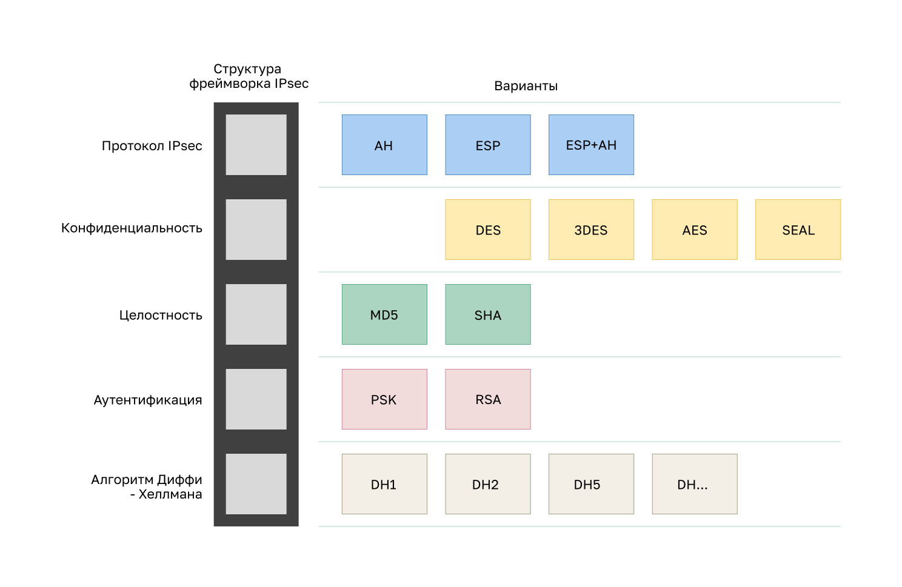
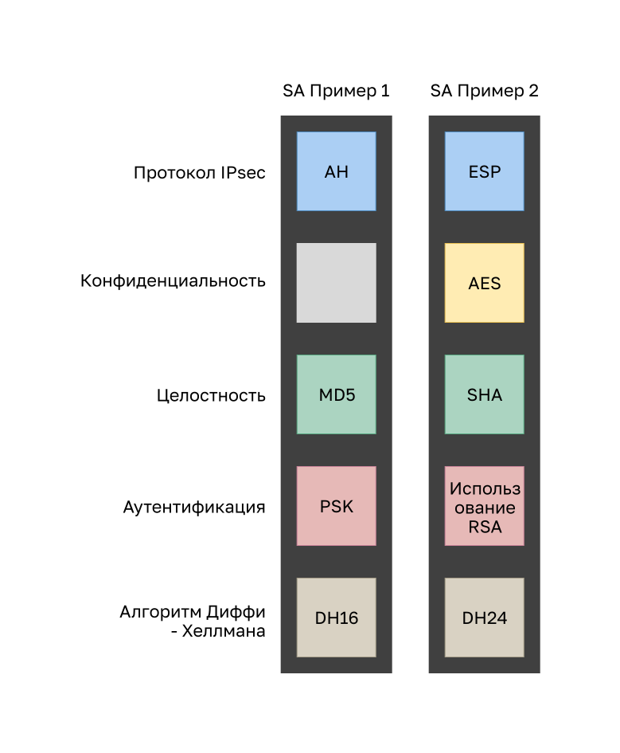
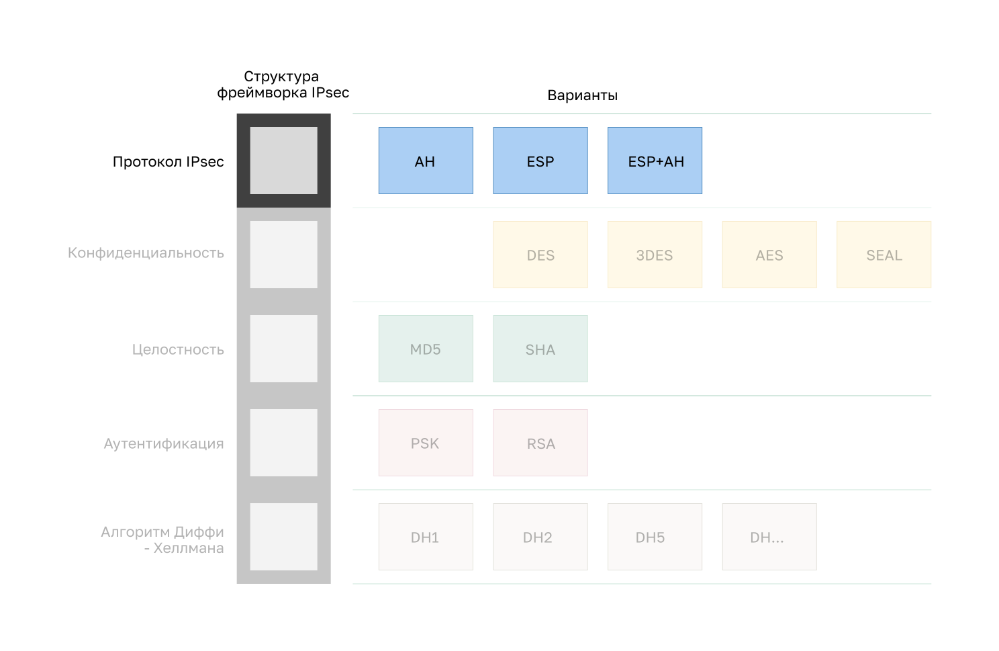
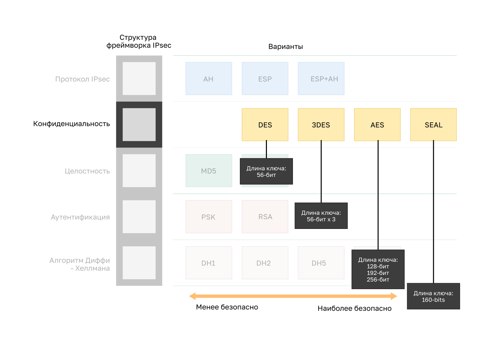
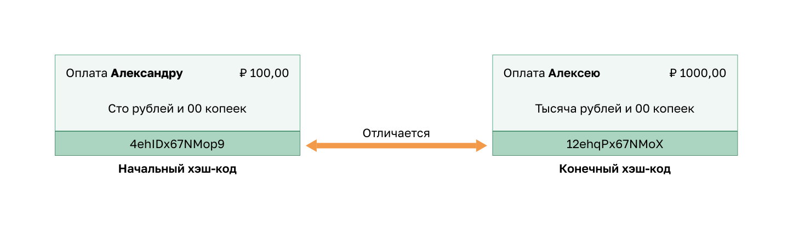
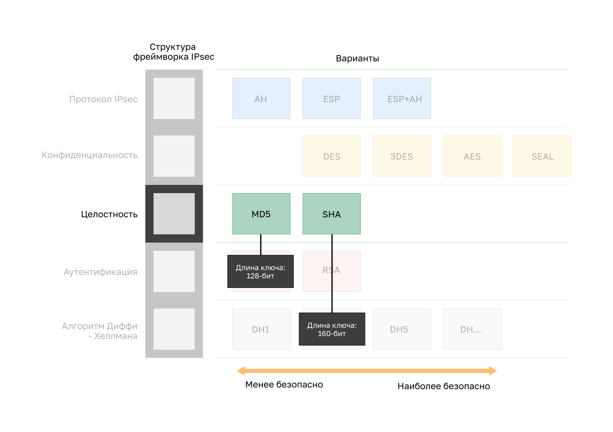
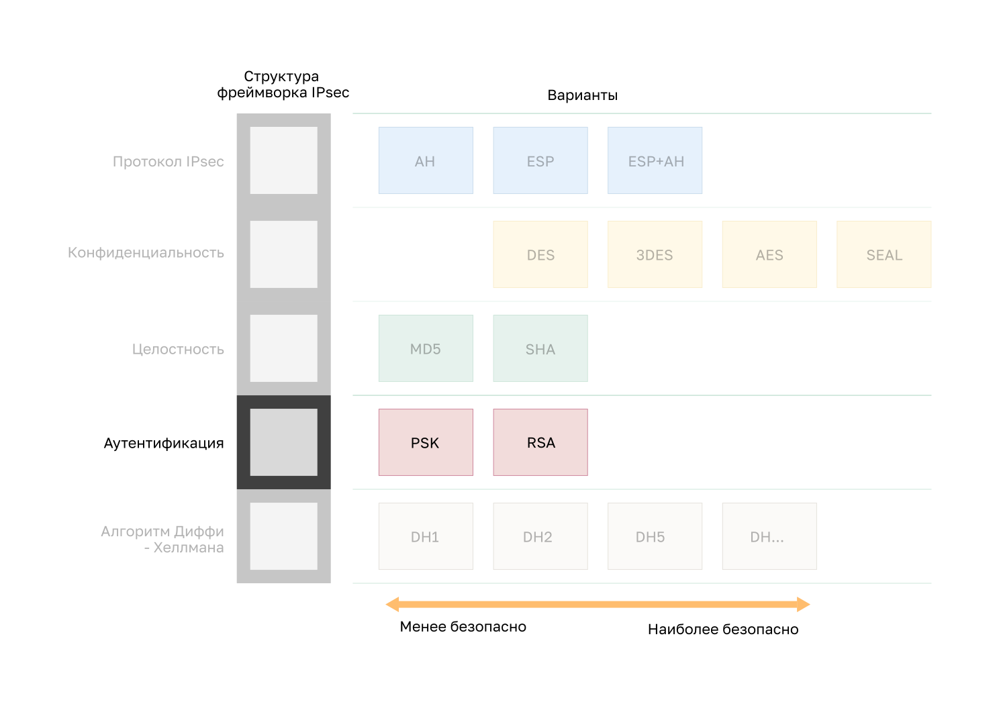
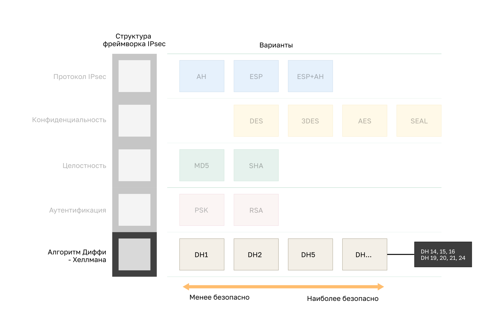

<!-- 8.3.1 -->
В предыдущей теме вы узнали о типах VPN. Важно понимать, как с ними работает IPsec.

<!-- 8.3.2 -->
## IPSec технологии

**IPsec** — это стандарт IETF (впервые описан в RFC 2401–2412, сейчас его архитектуру описывает RFC 4301), который определяет, как можно защитить VPN в IP-сетях. Этот протокол защищает и аутентифицирует IP-пакеты между источником и адресатом. IPsec работает на сетевом уровне (уровень 3) и защищает все, что передается поверх IP, а в туннельном режиме — и сам исходный IP-пакет.

Благодаря своей структуре IPsec выполняет основные функции обеспечения безопасности:

* **конфиденциальность** — IPsec использует алгоритмы шифрования и не дает злоумышленникам прочитать содержимое пакета;
* **целостность** — IPsec использует алгоритмы хеширования, чтобы гарантировать, что пакеты не изменятся между источником и адресатом;
* **аутентификация источника** — IPsec использует протокол Internet Key Exchange (IKE) для аутентификации источника и получателя. Методы аутентификации — предварительно согласованные ключи (PSK) или цифровые подписи RSA с сертификатами;
* **Диффи-Хеллман** — безопасный обмен ключами, обычно с использованием различных групп алгоритма DH.

Чтобы обеспечить безопасную связь, протокол IPsec не привязывается ни к каким специальным правилам. С такой гибкой структурой он легко интегрирует новые технологии безопасности без обновления существующих стандартов. Доступные технологии соответствуют их конкретной функции. Структуру IPsec можно представить как пять открытых слотов, по одному на каждую функцию. Слот протокола IPsec заполняется вариантом AH, ESP или ESP+AH, слот конфиденциальности — DES, 3DES, AES или SEAL, слот целостности — MD5 или SHA, слот аутентификации — PSK или RSA, а слот Диффи-Хеллмана — одной из групп DH (DH1, DH2, DH5 и другими). Выбранные варианты вместе образуют уникальную ассоциацию безопасности (SA). Не все варианты одинаково надежны: DES и HMAC-MD5 в IPsec использовать нельзя (MUST NOT), 3DES не рекомендуется (SHOULD NOT) (RFC 8221), группа DH 1 запрещена, а группы 2 и 5 не рекомендуются (RFC 8247).

<!-- /courses/ensa-dl/ae8e8c8a-34fd-11eb-ba19-f1886492e0e4/aeb59c84-34fd-11eb-ba19-f1886492e0e4/assets/c6711693-1c46-11ea-af56-e368b99e9723.svg -->

<!--
На рисунке изображены параметры для структуры IPsec. Существует пять функций: протокол IPsec, конфиденциальность, целостность, аутентификация и Диффи-Хеллман. Каждая функция имеет доступные параметры. Варианты протокола IPsec: AH, ESP или ESP+AH. Параметры конфиденциальности: DES, 3DES, AES или SEAL. Варианты целостности: MD5 или SHA. Варианты аутентификации: PSK или RSA. Варианты Диффи-Хеллмана: DH1, DH2, DH5 и т. д.
-->

Функции безопасности перечислены в таблице.

| Функция IPSec | Описание |
| --- | --- |
| **Протокол IPsec** | Выбор протокола IPsec включает в себя Authentication Header (AH) или Encapsulating Security Payload (ESP). AH обеспечивает целостность и аутентификацию источника пакета, включая внешний IP-заголовок, но не шифрует его. ESP обеспечивает конфиденциальность (шифрование), а целостность и аутентификацию источника — по выбору. **Примечание:** AH, отдельно или вместе с ESP, не проходит через устройство NAT: NAT меняет IP-адреса, которые защищает контрольное значение целостности (ICV) AH (RFC 3715, раздел 2.1). Поэтому ESP+AH используется редко, а ESP в туннельном режиме проходит через NAT в инкапсуляции UDP, порт 4500 (NAT-T, RFC 3948). |
| **Конфиденциальность** | Шифрование обеспечивает конфиденциальность пакета уровня 3. Варианты включают в себя Data Encryption Standard (DES), Triple DES (3DES), Advanced Encryption Standard (AES), или Software-Optimized Encryption Algorithm (SEAL). Доступна опция без шифрования. |
| **Целостность** | Гарантирует, что данные поступают в пункт назначения без изменений с использованием алгоритма хеширования, такого как Secure Hash Algorithm (SHA). Устаревший Message Digest 5 (MD5) применять не следует. |
| **Аутентификация** | IPsec использует Internet Key Exchange (IKE) для взаимной аутентификации узлов, которые устанавливают защищенную связь. Узлы IPsec аутентифицируют друг друга предварительно согласованными ключами (PSK) или цифровыми подписями RSA с сертификатами. |
| **Алгоритм Диффи-Хеллмана** | IPSec использует алгоритм DH для предоставления метода обмена открытыми ключами между двумя участниками для установления общего секретного ключа. Существует несколько групп на выбор: DH14, 15, 16 и DH19, 20, 21. DH1 запрещена, а DH2, DH5 и DH24 не рекомендуются (RFC 8247). |

Ассоциация безопасности (SA) — основа IPsec. При установлении VPN-соединения одноранговые узлы должны совместно использовать одну и ту же SA для согласования параметров обмена ключами, установления общего ключа, аутентификации друг друга и согласования параметров шифрования. Например, SA одной реализации может использовать AH без шифрования, MD5 для целостности, PSK для аутентификации и группу DH 16, а SA другой — ESP с шифрованием AES, SHA для целостности, RSA для аутентификации и группу DH 24. Сегодня HMAC-MD5 в IPsec запрещен, а группа DH 24 не рекомендуется.

**Примеры ассоциации безопасности IPsec**

<!-- /courses/ensa-dl/ae8e8c8a-34fd-11eb-ba19-f1886492e0e4/aeb59c84-34fd-11eb-ba19-f1886492e0e4/assets/c6722803-1c46-11ea-af56-e368b99e9723.svg -->

<!--
Рисунок показывает пример SA для двух различных реализаций. В первом примере есть AH для протокола IPSec, ничего не выбрано для конфиденциальности, MD5 для целостности, PSK для аутентификации и DH16 для Диффи-Хеллмана. Во втором примере есть ESP для протокола IPsec, AES, выбранный для конфиденциальности, SHA для целостности, RSA для аутентификации и DH24 для Диффи-Хеллмана.
-->

<!-- 8.3.3 -->
## Инкапсуляция протокола IPSec

Выбор инкапсуляции протокола IPsec — основа фреймворка. IPsec инкапсулирует пакеты с использованием Authentication Header (AH) или Encapsulating Security Payload (ESP).

Выбор AH или ESP определяет, какие другие блоки будут доступны. Например, AH не шифрует данные, поэтому при выборе AH блок конфиденциальности не используется.

<!-- /courses/ensa-dl/ae8e8c8a-34fd-11eb-ba19-f1886492e0e4/aeb59c84-34fd-11eb-ba19-f1886492e0e4/assets/c672eb52-1c46-11ea-af56-e368b99e9723.svg -->

* AH уместен, когда конфиденциальность не требуется или не разрешается. Он обеспечивает аутентификацию и целостность данных, но не их конфиденциальность. Весь текст транспортируется в незашифрованном виде.
* ESP обеспечивает аутентификацию для внутреннего IP-пакета и заголовка ESP, а также конфиденциальность с помощью шифрования IP-пакета. Аутентификация обеспечивает проверку подлинности источника данных и их целостность. Хотя процедуры шифрования и аутентификации в ESP необязательные, необходимо выбрать минимум одну из них.

<!--
На рисунке изображены параметры для структуры IPsec. Существует пять функций: протокол IPsec, конфиденциальность, целостность, аутентификация и Диффи-Хеллман. Каждая функция имеет доступные параметры. Варианты протокола IPsec: AH, ESP или ESP + AH. Параметры конфиденциальности: DES, 3DES, AES или SEAL. Варианты целостности: MD5 или SHA. Варианты аутентификации: PSK или RSA. Варианты Диффи-Хеллмана: DH1, DH2, DH5 и т.д.
-->

<!-- 8.3.4 -->
## Конфиденциальность

Конфиденциальность достигается путем шифрования данных. Например, Иван отправляет через Интернет платеж Аристарху на 100 рублей. Ключ и алгоритм шифрования превращают сообщение в нечитаемую последовательность символов, и злоумышленник, перехвативший ее, не может ее прочитать. Аристарх с помощью ключа и алгоритма расшифровки восстанавливает исходное сообщение.

Степень конфиденциальности зависит от алгоритма шифрования и длины используемого в нем ключа. При попытке подобрать ключ полным перебором количество возможных вариантов зависит от длины ключа, а время перебора — от мощности компьютера. Чем короче ключ, тем проще его взломать. Относительно мощный компьютер будет расшифровывать 64-битный ключ около года. Для 128-битного понадобится приблизительно 10 квинтиллионов лет.

<!-- /courses/ensa-dl/ae8e8c8a-34fd-11eb-ba19-f1886492e0e4/aeb59c84-34fd-11eb-ba19-f1886492e0e4/assets/c6738793-1c46-11ea-af56-e368b99e9723.svg -->

<!--
На рисунке Гейл отправляет Джереми сто долларов через Интернет и шифрующую/дешифрующую передачу. Используя длину ключа и алгоритм шифрования, передача зашифровывается, в результате чего сто долларов превращаются в 4ehiDx67NMop9eRU781OPotVBn45TR. Зашифрованные данные отправляются через Интернет. Злоумышленник, перехватывающий их, не может это прочитать. Когда они приходят на компьютер Джереми, данные расшифровываются, что приводит к получению ста долларов от Гейла.
-->

Все алгоритмы шифрования, доступные в IPsec для обеспечения конфиденциальности (DES, 3DES, AES и SEAL), представляют собой криптосистемы с симметричным ключом.

<!-- /courses/ensa-dl/ae8e8c8a-34fd-11eb-ba19-f1886492e0e4/aeb59c84-34fd-11eb-ba19-f1886492e0e4/assets/c673d5b2-1c46-11ea-af56-e368b99e9723.svg -->

* **DES** использует 56-битный ключ.
* **3DES** — вариант DES. Он использует три независимых 56-битных ключа шифрования на 64-битный блок, что обеспечивает более надежную защиту по сравнению с DES. Сейчас 3DES считается устаревшим вариантом: RFC 8221 больше не рекомендует его для IPsec, и предпочтение отдается AES.
* **AES** безопаснее чем DES и вычислительно эффективнее чем 3DES. Он предлагает три длины ключа: 128, 192 и 256 бит.
* **SEAL** — потоковый шифр, который непрерывно шифрует данные, а не блоки. SEAL использует 160-битный ключ.

<!--
На рисунке показана разная длина ключа и сила различных алгоритмов шифрования, в том числе DES, 3DES, AES или SEAL. Длина ключа для DES — 56 бит, это наименее безопасный алгоритм шифрования. 3DES — второй наименее безопасный вариант. Его длина ключа составляет 3 раза по 56 бит. AES более надежен. Его длина ключа 128, 192 и 256 битов. Еще более безопасный вариант — SEAL. Он имеет длину ключа 160 бит. 
-->

<!-- 8.3.5 -->
## Целостность

Целостность означает, что принятые данные точно совпадают с отправленными. Теоретически, данные можно перехватить и изменить. Например, злоумышленник перехватил платеж Александру на 100 рублей, заменил получателя на Алексея, а сумму — на 1000 рублей, чтобы украсть деньги. Если подделка выполнена качественно, без проверки целостности она может оказаться успешной. Хеш-код измененного платежа отличается от хеш-кода исходного, поэтому изменение можно обнаружить, если злоумышленник не может подделать и сам хеш-код.

<!-- /courses/ensa-dl/ae8e8c8a-34fd-11eb-ba19-f1886492e0e4/aeb59c84-34fd-11eb-ba19-f1886492e0e4/assets/c6755c50-1c46-11ea-af56-e368b99e9723.svg -->

<!--
На рисунке денежная сумма и данные изменяются, что приводит к различным результатам хеширования. Начальная сумма у Алекса была 4ehiDx67NMop9. Ее перехватили, имя изменили на Джереми, в результате чего хеш стал 12ehqPx67NMoX. Начальный и конечный хеш различаются.
-->

Так как данные сети VPN передаются по публичному Интернету, нужен специальный метод обеспечения целостности данных, который сохранит передаваемый контент. **Hash-based Message Authentication Code** (HMAC, код аутентификации сообщений на основе хеша) – это алгоритм обеспечения целостности данных с помощью хеш-значения и секретного ключа: без ключа злоумышленник не может вычислить правильный хеш-код для измененного сообщения. В структуре IPsec для целостности предлагаются два алгоритма HMAC: HMAC-MD5 со 128-битным ключом (RFC 8221 запрещает использовать его в IPsec) и более безопасный HMAC-SHA-1 со 160-битным ключом.

**Примечание.** Сегодня алгоритм SHA-1 считается устаревшим, и для обеспечения целостности рекомендуется применять, по крайней мере, алгоритм SHA-256. 

<!-- /courses/ensa-dl/ae8e8c8a-34fd-11eb-ba19-f1886492e0e4/aeb59c84-34fd-11eb-ba19-f1886492e0e4/assets/c675d181-1c46-11ea-af56-e368b99e9723.svg -->

* Message-Digest 5 (MD5) — устаревший алгоритм: RFC 8221 запрещает использовать HMAC-MD5 в IPsec. В HMAC-MD5 128-битный общий секретный ключ объединяется с сообщением произвольной длины, и они обрабатываются алгоритмом хеширования MD5. В результате создается 128-битный хеш-код.
* Secure Hash Algorithm (SHA) использует 160-битный секретный ключ. Он объединяется с сообщением переменной длины. Они обрабатываются алгоритмом HMAC-SHA-1. В результате создаётся 160-битный хеш-код.

<!--
На рисунке показаны различные алгоритмы хеширования и их длина ключа. Алгоритмы: MD5 и SHA. Наименее безопасный — MD5 с 128-битным ключом. SHA с длиной ключа 160 бит безопаснее.
-->

<!-- 8.3.6 -->
## Аутентификация

При ведении бизнеса с удаленными партнерами важно знать, с кем вы общаетесь по телефону, электронной почте или факсу. Это же справедливо и для сетей VPN. Устройство на другом конце туннеля необходимо сначала аутентифицировать, только после этого коммуникационный тракт можно считать безопасным. Для этого в IPsec используются два метода: менее безопасный PSK и более безопасный RSA.

<!-- /courses/ensa-dl/ae8e8c8a-34fd-11eb-ba19-f1886492e0e4/aeb59c84-34fd-11eb-ba19-f1886492e0e4/assets/c676bbe0-1c46-11ea-af56-e368b99e9723.svg -->

* Значение общего секретного ключа (PSK) вводится в каждый узел вручную. PSK объединяется с другой информацией для формирования ключа аутентификации. PSK легко настраиваются вручную, но они плохо масштабируются, потому что каждый узел IPsec должен быть настроен с PSK каждого другого узла, с которым он связывается.
* Аутентификация Rivest, Shamir и Adleman (RSA) использует цифровые сертификаты для аутентификации партнеров. Локальное устройство создает хеш-код и шифрует его с помощью своего закрытого ключа. Зашифрованный хеш прикрепляется к сообщению и пересылается на удаленный конец и действует как подпись. На удаленной стороне он расшифровывается с помощью открытого ключа локальной стороны. Если он совпадает с расчётным значением, значит подпись подлинная. Каждый узел должен подтвердить подлинность противоположного, прежде чем туннель будет считаться безопасным.

<!--
На рисунке показаны различные параметры аутентификации. Варианты: PSK как наименее безопасный и RSA как более безопасный.
-->

При аутентификации PSK на локальном устройстве PSK и идентификационная информация обрабатываются алгоритмом хеширования, чтобы сформировать хеш для локального узла (Hash\_L). Односторонняя аутентификация устанавливается путем отправки Hash\_L через Интернет на удаленное устройство. Удаленное устройство само вычисляет хеш из своего экземпляра PSK и той же идентификационной информации. Если вычисленный хеш совпадает с полученным, локальное устройство проходит проверку подлинности. Когда удаленное устройство его аутентифицирует, процесс начинается в обратном направлении, и все шаги повторяются с удаленного устройства на локальное.
  
**Аутентификация PSK**

<!-- /courses/ensa-dl/ae8e8c8a-34fd-11eb-ba19-f1886492e0e4/aeb59c84-34fd-11eb-ba19-f1886492e0e4/assets/c677cd50-1c46-11ea-af56-e368b99e9723.svg -->

<!--
На рисунке показан пример аутентификации PSK. На локальном устройстве ключ аутентификации и идентификационная информация отправляются через алгоритм хеширования, чтобы сформировать хеш. Он отправляется на удаленное устройство, которое независимо создает и вычисляет один и тот же хеш, чтобы сравнить полученный и вычисленный. Хеши совпадают и локальное устройство проходит проверку подлинности.
-->

При аутентификации RSA на локальном устройстве ключ аутентификации и идентификационная информация обрабатываются алгоритмом хеширования, чтобы сформировать хеш для локального узла (Hash\_L). Затем Hash\_L шифруется закрытым ключом локального устройства. Это создает цифровую подпись. Она и цифровой сертификат пересылаются на удаленное устройство. Открытый ключ для расшифровки подписи включен в сертификат. Удаленное устройство проверяет подпись, расшифровывая ее с помощью открытого ключа. В результате получается Hash\_L. Затем удаленное устройство самостоятельно создает Hash\_L из сохраненной информации. Если вычисленный хеш для локального узла равен расшифрованному, локальное устройство аутентифицируется. Когда удаленное устройство аутентифицирует локальное, все шаги повторяются в обратном направлении.

**Аутентификация RSA**

<!-- /courses/ensa-dl/ae8e8c8a-34fd-11eb-ba19-f1886492e0e4/aeb59c84-34fd-11eb-ba19-f1886492e0e4/assets/c6784281-1c46-11ea-af56-e368b99e9723.svg -->

<!--
На рисунке показан пример аутентификации RSA. На локальном устройстве ключ аутентификации и идентификационная информация отправляются через алгоритм хеширования, чтобы сформировать хеш. Он, в свою очередь, шифруется с помощью закрытого ключа локального устройства, что создает цифровую подпись. Цифровые сертификат и подпись отправляются на удаленное устройство. Оно расшифровывает подпись с помощью открытого ключа локального устройства, в результате чего получается хеш. Затем устройство независимо создает и вычисляет один и тот же хеш, чтобы сравнить полученный и вычисленный. Они совпадают и локальное устройство проходит проверку подлинности.
-->

<!-- 8.3.7 -->
## Безопасный обмен ключами с Диффи-Хеллманом

Алгоритмы требуют симметричного общего секретного ключа для выполнения шифрования и дешифрования. Каким образом зашифровывающее и расшифровывающее устройства могут получить информацию об общем секретном ключе? Самый простой метод — алгоритм Диффи-Хеллмана (DH). В структуре IPsec он выбирается как группа DH: от устаревших групп 1, 2 и 5 до более безопасных групп 14, 15, 16 и 19, 20, 21.

<!-- /courses/ensa-dl/ae8e8c8a-34fd-11eb-ba19-f1886492e0e4/aeb59c84-34fd-11eb-ba19-f1886492e0e4/assets/c678b7b3-1c46-11ea-af56-e368b99e9723.svg -->

<!--
На рисунке показаны различные варианты Диффи-Хеллмана. Варианты Диффи-Хеллмана идут от наименее защищенного к наиболее безопасному: начиная с DH1, далее DH2, DH5, DH14, DH15, DH16, DH19, DH20, DH21 и к самому надежному DH24.
-->

DH предоставляет возможность двум партнерам установить общий секретный ключ, который знают только они, даже если они обмениваются данными по небезопасному каналу. Варианты обмена ключами DH указаны как группы DH:

* группы DH 1, 2 и 5 больше не должны использоваться, они поддерживают размер ключа 768 бит, 1024 бит и 1536 бит соответственно;
* группы DH 14, 15 и 16 используют ключи больших размеров с 2048 битами, 3072 битами и 4096 битами соответственно и рекомендуются для использования до 2030 года;
* группы DH 19, 20 и 21 с соответствующими размерами ключей 256 бит, 384 бит и 521 бит поддерживают криптографию с эллиптической кривой (ECC), которая сокращает время для генерации ключей. Группа DH 24 к ним не относится: это 2048-битная группа MODP без эллиптической кривой (RFC 5114), и RFC 8247 не рекомендует ее использовать.

Выбранная вами группа DH должна быть достаточно сильной или иметь достаточно битов для защиты ключей IPsec во время согласования. Например, если в алгоритмах шифрования или аутентификации используется 128-битный ключ, используйте группу 14, 19 или 20. Если же используется 256-битный ключ или длиннее, используйте группу 21.

<!-- 8.3.8 -->

<!-- 8.3.9 -->
<!-- quiz -->

