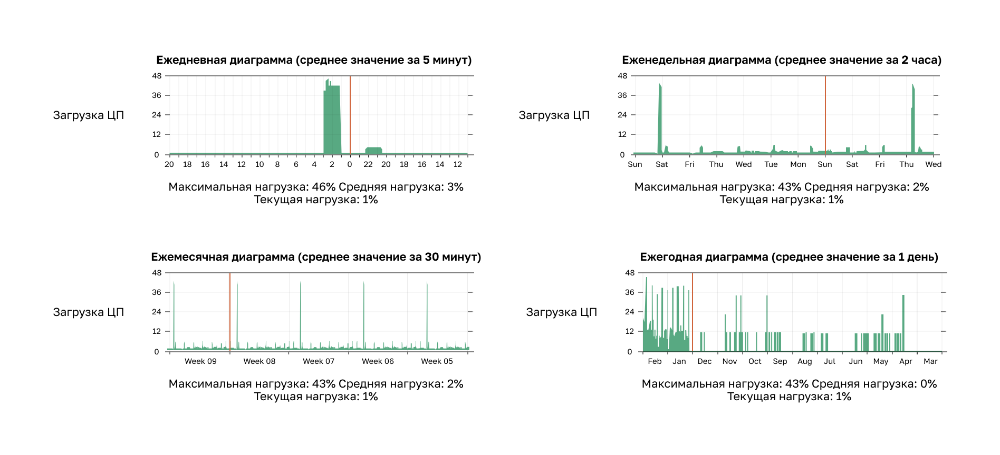

<!-- 12.1.1 -->
## Обзор документации

Любые сложные действия, как устранение неполадок в сети, нужно начать с хорошей документации. Для эффективного мониторинга и устранения неполадок нужна точная и полная сетевая документация.

Общая сетевая документация включает:

* схемы физической и логической топологии сети;
* документация по сетевому устройству со всей необходимой информацей;
* документация по базовым показателям производительности сети.

Вся сетевая документация должна храниться в одном месте в виде печатной копии либо в сети на защищенном сервере. Резервная документация должна поддерживаться и храниться в отдельном месте.

<!-- 12.1.2 -->
## Диаграммы топологии сети

На диаграммах топологии сети фиксируются местоположение, назначение и состояние устройств в сети. Есть два типа таких диаграмм: физическая и логическая топология.

**Физическая топология**

Физическая топология сети описывает расположение устройств, подключенных к сети. Для отладки необходимо знать, каким образом устройства подключены друг к другу. Информация, записанная по такой топологии, обычно включает:

* имя устройства;
* расположение (адрес, номер комнаты, расположение стойки);
* используемые интерфейс и порты;
* тип кабеля.

Например, в документации физической топологии сети указано, что маршрутизатор Central стоит в здании A (главный офис), помещение 107, коммутационный шкаф 1, стойка 1, полка 1, а сервер SRV1 подключен к его интерфейсу G0/0/0 и стоит в стойке 2 на полке 1 того же шкафа. Через интерфейс G0/0/1 Central соединен с маршрутизатором Branch-1 в здании B (исследования и разработки, помещение 137, шкаф 2), через S0/1/1 по последовательному каналу — с маршрутизатором Branch-2 в удаленном офисе продаж (помещение 7, шкаф 3), а через G0/1/0 по Metro Ethernet — с маршрутизатором интернет-провайдера, у которого размещен веб-сервер SRV2. Для каждого компьютера указано помещение: PC1 — 1307, PC2 — 1305, PC3 — конференц-зал.

<!-- /courses/ensa-dl/ae8eb396-34fd-11eb-ba19-f1886492e0e4/aeb638ca-34fd-11eb-ba19-f1886492e0e4/assets/c6e61f82-1c46-11ea-af56-e368b99e9723.svg -->

<!--
На диаграмме показана физическая топология сети с различным оборудованием, расположенным в трех разных местоположениях/проводных шкафах. В каждом из них есть взаимосвязанные маршрутизаторы и подключение к облаку Интернета. В верхней части диаграммы находится Главный офис (корпус A) Rm: 107 — Проводка Шкаф 1. Он содержит центральный маршрутизатор, установленный на стойке 1 полки 1, и сервер SRV1. У центрального маршрутизатора четыре подключения, в том числе через интерфейс G0/0/0 к SRV1, установленный на стойке 2 полки 1. Central подключен справа через канал Ethernet на интерфейсе G0/1/0 к маршрутизатору ISP, в облаке Интернета. Также в облаке находится SRV2, веб-сервер, размещенный на ISP. Центральная сеть подключается через интерфейс G0/0/1 к G0/0/1 на маршрутизаторе Branch-1, расположенном в области исследований и разработок (корпус B) Rm: 137 — Wiring Closet 2 в левом нижнем углу схемы. Филиал-1 монтируется на стойку 2 полки 1 и подключается через G0/0/0 для переключения S1 на порт G0/1. S1 устанавливается на стойку 2 полки 2 и имеет подключение через Fa0/5 к хосту PC1 в Rm 1307. У S1 два соединения для переключателя S2, который установлен на стеллаже 2 полки 3. Они подключаются через Fa0/1 к Fa0/1 и через Fa0/2 к Fa0/2. У S2 подключение через Fa0/5 к хосту PC2 в Rm 1305. Последнее соединение с центральным маршрутизатором — последовательное подключение через S0/1/1 к маршрутизатору Branch-2 S0/1/1, расположенному в удаленном офисе продаж Rm: 7 — Wiring Closet 3 в правом нижнем углу схемы. Ветка-2 монтируется на стойке 1 полки 1. Он подключен через G0/0/0 для переключения S3 на порт G0/1. S3 устанавливается на стойку 1 полки 2 и подключается через Fa0/5 для размещения PC3 в конференц-зале.
-->

**Логическая топология IPv4**

Диаграммы логической сетевой топологии отображают подключение устройств к сети. Это относится к тому, как одни устройства передают данные при взаимодействии с другими. Для обозначения сетевых элементов, например маршрутизаторов, серверов, компьютеров, концентраторов сетей VPN и устройств обеспечения безопасности, используют условные обозначения (символы). Кроме того, могут быть показаны подключения между несколькими узлами, но они не представляют собой реальных физических местоположений.

Информация, записанная по логической топологии, обычно включает:

* идентификаторы устройств;
* IP-адрес и длину префиксов;
* идентификаторы интерфейсов;
* протоколы маршрутизации и статические маршруты;
* информацию уровня 2 (например, VLAN, магистрали, EtherChannels).

Например, в логической топологии той же сети Central соединен с SRV1 сетью 10.0.0.0/30 (G0/0/0 — .1, SRV1 — .2), с Branch-1 — сетью 10.1.1.0/30, с Branch-2 — последовательной сетью 10.2.2.0/30, а через G0/1/0 — с маршрутизатором интернет-провайдера сетью 209.165.200.224/30. Коммутаторы S1 и S2 за Branch-1 соединены каналом EtherChannel Po1, а канал от S1 к Branch-1 — магистральный, с сетями VLAN 10 (LAN-1, 192.168.10.0/24), 20 (LAN-2, 192.168.20.0/24), 77 (управление, 192.168.77.0/24), собственной VLAN 99 и неиспользуемой VLAN 999. За Branch-2 находится LAN 3 (192.168.30.0/24).

<!-- /courses/ensa-dl/ae8eb396-34fd-11eb-ba19-f1886492e0e4/aeb638ca-34fd-11eb-ba19-f1886492e0e4/assets/c6e6bbc2-1c46-11ea-af56-e368b99e9723.svg -->

<!--
На диаграмме показана логическая топология сети с различным оборудованием, связанной IPv4 адресацией и информацией уровня 2. Есть три взаимосвязанных маршрутизатора и подключение к облаку Интернета. В верхней части диаграммы находится центральный маршрутизатор с четырьмя соединениями. Он подключен слева к сети 10.0.0.0/30 через интерфейс G0/0/0, адрес .1, к серверу SRV1, адрес .2. Центральный подключен справа к сети 209.165.200.224/30 через G0/1/0, адрес .226, к маршрутизатору ISP, в облаке Интернета по адресу .225. Также в облаке находится SRV2 по адресу 209.165.201.10. Центральный канал подключается в левом нижнем углу к сети 10.1.1.0/30 через интерфейс G0/0/1, адрес .1, к маршрутизатору Branch-1 по адресу G0/0/1, адрес .2. Branch-1 подключается через магистральный канал на G0/0/0 для переключения S1 на порт G0/1. У S1 IP-адрес 192.168.77.2 и подключение через Fa0/5 к узлу PC1 по адресу 192.168.10.10. Также у S1 два соединения, образующие EtherChannel Po1 для коммутатора S2. Они подключаются через Fa0/1 к Fa0/1 и через Fa0/2 к Fa0/2. У S2 IP-адрес 192.168.77.3 и подключение через Fa0/5 к узлу PC2 по адресу 192.168.20.10. В таблице показана конфигурация VLAN для расположения Branch-1: VLAN 10, имя LAN-1, сеть 192.168.10.0/24; VLAN 20, имя LAN-2, сеть 192.168.20.0/24; VLAN 77, управление именем, сеть 192.168.77.0/24; VLAN 99, имя Native; и VLAN 999, имя Unused. Последнее соединение центрального маршрутизатора — последовательное соединение в правом нижнем углу к сети 10.2.2.0/30 через S0/1/1, адрес .1, к маршрутизатору Branch-2 S0/1/1, адрес .2. Branch-2 подключен к сети 192.168.30.0/24 через G0/0/0, адрес .1, к коммутатору S3 на порту G0/1. S3 подключается через Fa0/5 к хосту PC3 по адресу .10.
-->

**Логическая топология IPv6**

Несмотря на то, что IPv6-адреса также могут отображаться на диаграмме этой топологии, для более четкого представления целесообразно создать отдельную диаграмму логической топологии сети IPv6.

Например, в логической топологии IPv6 той же сети Central соединен с SRV1 сетью 2001:db8:acad:1::/64, с Branch-1 — сетью 2001:db8:feed:2::/64, с Branch-2 — 2001:db8:feed:3::/64, а с маршрутизатором интернет-провайдера — 2001:db8:feed:1::/64; за Branch-1 находится LAN2 (2001:db8:acad:2::/64), за Branch-2 — LAN3 (2001:db8:acad:3::/64).

<!-- /courses/ensa-dl/ae8eb396-34fd-11eb-ba19-f1886492e0e4/aeb638ca-34fd-11eb-ba19-f1886492e0e4/assets/c6e709e2-1c46-11ea-af56-e368b99e9723.svg -->

<!--
На диаграмме показана логическая топология сети с различным оборудованием, связанной IPv6 адресацией и информацией уровня 2. Есть три взаимосвязанных маршрутизатора и подключение к облаку Интернета. В верхней части диаграммы находится центральный маршрутизатор с четырьмя соединениями. Он подключен слева к сети 2001:db8:acad:1::/64 через интерфейс G0/0/0, адрес :1, к серверу SRV1, адрес :2. Центральный подключен справа к сети 2001:db8:feed:1::/64 через G0/1/0, адрес :226, к маршрутизатору ISP в облаке Интернета по адресу :225. Также в облаке находится SRV2 по адресу 2001:db8:feed:1::10/64. Central подключается в левом нижнем углу к сети 2001:db8:feed:2::/64 через интерфейс G0/0/1, адрес :1, к интерфейсу G0/0/1 маршрутизатора Branch-1, адрес :2. На значке Branch-1 есть надпись NAT64. Branch-1 через G0/0/0 подключен магистральным каналом к порту G0/1 коммутатора S1 в сети LAN2 2001:db8:acad:2::/64. S1 соединен с коммутатором S2 двумя каналами, Fa0/1 к Fa0/1 и Fa0/2 к Fa0/2, которые образуют EtherChannel Po1. S1 подключен через Fa0/5 к узлу PC1, а S2 — через Fa0/5 к узлу PC2. Последнее соединение центрального маршрутизатора — последовательное соединение в правом нижнем углу к сети 2001:db8:feed:3::/64 через S0/1/1, адрес :1, к интерфейсу S0/1/1 маршрутизатора Branch-2, адрес :2. Branch-2 подключен к сети LAN3 2001:db8:acad:3::/64 через G0/0/0, адрес :1, к порту G0/1 коммутатора S3. S3 имеет адрес :2 и подключен через Fa0/5 к узлу PC3 по адресу :10.
-->

<!-- 12.1.3 -->
## Документация по сетевым устройствам

В файлах настройки сети содержатся точные, актуальные записи об оборудовании и программном обеспечении, применяемом в сети. Документация должна содержать всю необходимую информацию о сетевых устройствах.

Многие организации создают документы или электронные таблицы для сбора соответствующей информации об устройствах.

**Документация по маршрутизатору**

В таблице приведен пример документации по сетевым устройствам для двух взаимосвязанных маршрутизаторов.

<table>
  <tr>
    <td><b>Устройство</b></td>
    <td><b>Модель</b></td>
    <td><b>Описание</b></td>
    <td><b>Местоположение</b></td>
    <td colspan="2"><b>ОС</b></td>
  </tr>
  <tr>
    <td><b>Центральный офис</b></td>
    <td>NR05</td>
    <td>Центральный пограничный маршрутизатор</td>
    <td>Здание A Rm: 137</td>
    <td colspan="2">NSALAB NetOS Software, Version 0.1.0, flash0:nr05-netos-0.1.0.bin</td>
  </tr>
  <tr>
    <td><b>Интерфейс</b></td>
    <td colspan="2"><b>Описание</b></td>
    <td><b>IPv4-адрес</b></td>
    <td><b>Адрес IPv6</b></td>
    <td><b>MAC-адрес</b></td>
    <td><b>Маршрутизация</b></td>
  </tr>
  <tr>
    <td>G0/0/0</td>
    <td colspan="2">Подключается к SRV1</td>
    <td>10.0.0.1/30</td>
    <td>2001:db8:acad:1::1/64</td>
    <td>a03d.6fe1.e180</td>
    <td>OSPF</td>
  </tr>
  <tr>
    <td>G0/0/1</td>
    <td colspan="2">Подключается к Branch-1</td>
    <td>10.1.1.1/30</td>
    <td>2001:db8:feed:2::1/64</td>
    <td>a03d.6fe1.e181</td>
    <td>OSPFv3</td>
  </tr>
  <tr>
    <td>G0/1/0</td>
    <td colspan="2">Подключение к интернет-провайдеру</td>
    <td>209.165.200.226/30</td>
    <td>2001:db8:feed:1::226/64</td>
    <td>a03d.6fc3.a132</td>
    <td>По умолчанию</td>
  </tr>
  <tr>
    <td>S0/1/1</td>
    <td colspan="2">Подключается к Branch-2</td>
    <td>10.2.2.1/30</td>
    <td>2001:db8:feed:3::1/64</td>
    <td>Н/Д (недоступно)</td>
    <td>OSPFv3</td>
  </tr>
  <tr>
    <td><b>Устройство</b></td>
    <td><b>Модель</b></td>
    <td><b>Описание</b></td>
    <td><b>Узел</b></td>
    <td colspan="2"><b>ОС</b></td>
  </tr>
  <tr>
    <td><b>Branch-1</b></td>
    <td>NR02</td>
    <td>Пограничный маршрутизатор Branch-1</td>
    <td>Здание B Rm: 107</td>
    <td colspan="2">NSALAB NetOS Software, Version 0.1.0, flash0:nr02-netos-0.1.0.bin</td>
  </tr>
  <tr >
    <td><b>Интерфейс</b></td>
    <td colspan="2"><b>Описание</b></td>
    <td><b>IPv4-адрес</b></td>
    <td><b>Адрес IPv6</b></td>
    <td><b>MAC-адрес</b></td>
    <td><b>Маршрутизация</b></td>
  </tr>
  <tr>
    <td>G0/0/0</td>
    <td colspan="2">Подключается к S1</td>
    <td>Конфигурация ROS (Router-on-a-stick)</td>
    <td>Конфигурация ROS (Router-on-a-stick)</td>
    <td>a03d.6fe1.9d90</td>
    <td>OSPF</td>
  </tr>
  <tr>
    <td>G0/0/1</td>
    <td colspan="2">Подключение к Central</td>
    <td>10.1.1.2/30</td>
    <td>2001:db8:feed:2::2/64</td>
    <td>a03d.6fe1.9d91</td>
    <td>OSPF</td>
  </tr>
</table>

**Документация по устройствам коммутатора LAN**

В этой таблице приведен пример документации устройства для коммутатора LAN.

<table>
  <tr>
    <td><b>Устройство</b></td>
    <td><b>Модель</b></td>
    <td><b>Описание</b></td>
    <td colspan="2"><b>Управление IP-адрес</b></td>
    <td colspan="4"><b>ОС</b></td>
    <td colspan="3"><b>VTP</b></td>
  </tr>
  <tr>
    <td><b>S1</b></td>
    <td>NS01</td>
    <td>Branch-1 коммутатор LAN1</td>
    <td colspan="2">192.168.77.2/24</td>
    <td colspan="4">NSALAB NetOS Software, Version 0.1.0, flash0:ns01-netos-0.1.0.bin</td>
    <td colspan="3">Domain: nsalab Mode: Server</td>
  </tr>
  <tr >
    <td><b>Порт</b></td>
    <td colspan="2"><b>Описание</b></td>
    <td><b>Доступ</b></td>
    <td colspan="2"><b>VLAN</b></td>
    <td><b>Trunk</b></td>
    <td><b>EtherChannel</b></td>
    <td colspan="2"><b>Собственная </b></td>
    <td><b>Включено</b></td>
  </tr>
  <tr>
    <td>Fa0/1</td>
    <td colspan="2">Port Channel 1, магистральный канал до S2 Fa0/1</td>
    <td>-</td>
    <td colspan="2">-</td>
    <td>Да</td>
    <td>Port-channel 1</td>
    <td colspan="2">99</td>
    <td colspan="2">Да</td>
  </tr>
  <tr>
    <td>Fa0/2</td>
    <td colspan="2">Port Channel 1, магистральный канал до S2 Fa0/2</td>
    <td>-</td>
    <td colspan="2">-</td>
    <td>Да</td>
    <td>Port-channel 1</td>
    <td colspan="2">99</td>
    <td colspan="2">Да</td>
  </tr>
  <tr>
    <td>Fa0/3</td>
    <td colspan="2">*** Not in use ***</td>
    <td>Да</td>
    <td colspan="2">999</td>
    <td>-</td>
    <td>-</td>
    <td colspan="2"></td>
    <td colspan="2">Shut</td>
  </tr>
  <tr>
    <td>Fa0/4</td>
    <td colspan="2">*** Not in use ***</td>
    <td>Да</td>
    <td colspan="2">999</td>
    <td>-</td>
    <td>-</td>
    <td colspan="2"></td>
    <td colspan="2">Shut</td>
  </tr>
  <tr>
    <td>Fa0/5</td>
    <td colspan="2">Порт доступа для пользователей</td>
    <td>Да</td>
    <td colspan="2">10</td>
    <td>-</td>
    <td>-</td>
    <td colspan="2"></td>
    <td colspan="2">Да</td>
  </tr>
  <tr>
    <td>…</td>
    <td colspan="2"></td>
    <td></td>
    <td colspan="2"></td>
    <td>-</td>
    <td>-</td>
    <td colspan="2"></td>
    <td colspan="2">-</td>
  </tr>
  <tr>
    <td>Fa0/23</td>
    <td colspan="2">Порт доступа для пользователей</td>
    <td>Да</td>
    <td colspan="2">20</td>
    <td>-</td>
    <td>-</td>
    <td colspan="2"></td>
    <td colspan="2">Да</td>
  </tr>
  <tr>
    <td>Fa0/24</td>
    <td colspan="2">*** Not in use ***</td>
    <td>Да</td>
    <td colspan="2">999</td>
    <td>-</td>
    <td>-</td>
    <td colspan="2"></td>
    <td colspan="2">Shut</td>
  </tr>
  <tr>
    <td>G0/1</td>
    <td colspan="2">Магистральный канал до Branch-1</td>
    <td>-</td>
    <td colspan="2">-</td>
    <td>Да</td>
    <td>-</td>
    <td colspan="2">99</td>
    <td colspan="2">Да</td>
  </tr>
  <tr>
    <td>G0/2</td>
    <td colspan="2">*** Not in use ***</td>
    <td>Да</td>
    <td colspan="2">999</td>
    <td></td>
    <td>-</td>
    <td colspan="2"></td>
    <td colspan="2"></td>
  </tr>
</table>

**Документация по оконечной системе**

Документация оконечной системы посвящена аппаратному и программному обеспечению, используемому на серверах, консолях управления сетью и пользовательских рабочих станциях. Если оконечная система настроена неправильно, это может отрицательно повлиять на общую производительность сети. Поэтому доступ к документации по устройствам оконечной системы может быть очень полезным при устранении неполадок.

В этой таблице приведен пример информации, которую можно записать в документацию по оконечной системе.

<table>
  <tr>
    <td><b>Устройство</b></td>
    <td><b>ОС</b></td>
    <td><b>Сервисы</b></td>
    <td><b>MAC-адрес</b></td>
    <td><b>IPv4 / IPv6 адресация</b></td>
    <td><b>Шлюз по умолчанию</b></td>
    <td><b>DNS</b></td>
  </tr>
  <tr>
    <td rowspan="2"><b>SRV1</b></td>
    <td rowspan="2">Сервер MS 2016</td>
    <td rowspan="2">SMTP, POP3, файловые службы, DHCP</td>
    <td rowspan="2">5475.d08e.9ad8</td>
    <td>10.0.0.2/30</td>
    <td>10.0.0.1</td>
    <td>10.0.0.1</td>
  </tr>
  <tr>
    <td>2001:db8:acad:1::2/64</td>
    <td>2001:db8:acad:1::1</td>
    <td>2001:db8:acad:1::1</td>
  </tr>
  <tr>
    <td rowspan="2"><b>SRV2</b></td>
    <td rowspan="2">Сервер MS 2016</td>
    <td rowspan="2">HTTP, HTTPS</td>
    <td rowspan="2">5475.d07a.5312</td>
    <td>209.165.201.10</td>
    <td>209.165.201.1</td>
    <td>209.165.201.1</td>
  </tr>
  <tr>
    <td>2001:db8:feed:1::10/64</td>
    <td>2001:db8:feed:1::1</td>
    <td>2001:db8:feed:1::1</td>
  </tr>
  <tr>
    <td rowspan="2"><b>PC1</b></td>
    <td rowspan="2">MS Windows 10</td>
    <td rowspan="2">HTTP, HTTPS</td>
    <td rowspan="2">5475.d017.3133</td>
    <td>192.168.10.10/24</td>
    <td>192.168.10.1</td>
    <td>192.168.10.1</td>
  </tr>
  <tr>
    <td>2001:db8:acad:2::251/64</td>
    <td>2001:db8:acad:2::1</td>
    <td>2001:db8:acad:1::1</td>
  </tr>
  <tr>
    <td><b>…</b></td>
    <td></td>
    <td></td>
    <td></td>
    <td></td>
    <td></td>
    <td></td>
  </tr>
</table>

<!-- 12.1.4 -->
## Формирование базовых показателей сети

За сетью наблюдают, чтобы отследить уровень производительности сети и сравнить его с ранее определенными базовыми показателями. Базовый уровень используется для установления нормальной производительности сети или системы, чтобы определить ее «характер» в нормальных условиях.

Чтобы сформировать базовый уровень производительности сети, нужно собрать данные о производительности портов и устройств, необходимых для обеспечения работы.

Базовый показатель сети отвечает на вопросы:

* Как сеть работает в течение обычного (среднего) дня?
* Где происходит большинство ошибок?
* Какая часть сети используется наиболее интенсивно?
* Какая часть сети используется в наименьшей степени?
* Какие устройства необходимо отслеживать и какие пределы нужно установить?
* Может ли сеть поддерживать определенные политики?

Измерив начальный уровень производительности и доступности наиболее важных сетевых устройств и каналов, сетевой администратор определяет разницу между аномальным и нормальным поведением сети при ее расширении или изменении моделей трафика. Базовые показатели также дают понять, удовлетворяет ли текущая схема сети требования бизнеса. Если базовые показатели отсутствуют, то нет никакого стандарта для определения оптимальных уровней сетевого трафика и уровней загруженности.

Анализ после определения исходных базовых показателей позволяет обнаружить скрытые проблемы. Собранные данные позволяют увидеть истинные причины реальной или потенциальной перегрузки в сети. Эти данные могут позволить определить неэффективные участки, которые часто приводят к перепроектированию сети с учетом показателей качества и пропускной способности.

Базовый показатель производительности сети — основа для измерения эффекта от модификаций и последующих мер по поиску и устранению неполадок. Поэтому важно внимательно подойти к его формированию.

<!-- 12.1.5 -->
## Шаг 1. Определите типы данных, которые необходимо собирать.

Определяя начальные базовые показатели, начните с выбора нескольких переменных, которые представляют определенные политики. Если выберете слишком много точек данных, объем собираемой информации может оказаться крайне большим. Это очень усложнит анализ собранных данных. Начните с самого простого и постепенно вносите изменения по ходу работы. Рекомендуется начать с определения коэффициента использования интерфейсов и ЦП.

<!-- 12.1.6 -->
## Шаг 2. Определите требуемые устройства и порты.

Определите устройства и порты, на которых необходимо измерять данные о производительности, с помощью топологии сети. К требуемым устройствам и портам относятся:

* порты сетевых устройств, которые подключаются к другим сетевым устройствам;
* серверы;
* основные пользователи;
* любые другие объекты, наиболее важные для эксплуатации.

Логическая диаграмма топологии сети может быть полезна при определении основных устройств и портов, подлежащих наблюдению. Например, в ходе тестирования базовых показателей администратор наблюдает за устройствами SRV1, SRV2 и PC1 и за портами: G0/0/0, G0/1/0 и S0/1/1 маршрутизатора Central; G0/0/1 и G0/0/0 маршрутизатора Branch-1; G0/1, Fa0/1, Fa0/2 и Fa0/5 коммутатора S1; S0/1/1 маршрутизатора Branch-2.

<!-- /courses/ensa-dl/ae8eb396-34fd-11eb-ba19-f1886492e0e4/aeb638ca-34fd-11eb-ba19-f1886492e0e4/assets/c6e81b53-1c46-11ea-af56-e368b99e9723.svg -->

<!--
Диаграмма представляет собой логическую топологию сети IPv4 с маршрутизаторами Central, Branch-1, Branch-2 и ISP, коммутаторами S1–S3, серверами SRV1 и SRV2 и компьютерами PC1–PC3, на которой выделены порты/интерфейсы и устройства, представляющие интерес. Выделены устройства SRV1, SRV2 и PC1. Выделенные порты/интерфейсы: Central G0/0/0, G0/1/0 и S0/1/1; Branch-1 G0/0/1 и G0/0/0; S1 G0/1, Fa0/1, Fa0/2 и Fa0/5; и Branch-2 S0/1/1.
-->

Интересующие устройства включают PC1 (терминал администратора) и два сервера (SRV1 и SRV2). К числу портов, представляющих интерес, как правило, относятся интерфейсы маршрутизатора и ключевые порты коммутаторов.

Благодаря сокращению списка опрашиваемых портов можно оптимизировать получаемые результаты и уменьшить нагрузку по управлению сетями. Помните, интерфейс на маршрутизаторе или коммутаторе может быть виртуальным, например виртуальный интерфейс коммутатора (SVI).

<!-- 12.1.7 -->
## Шаг 3. Определите длительность сбора базовых показателей

Интервала времени и объема собираемых сведений о базовых показателях должно быть достаточно, чтобы сформировать типичную картину сети. Крайне важно наблюдать за ежедневными тенденциями сетевого трафика и за тенденциями за более длительный период времени (неделю или месяц). Поэтому при сборе данных для последующего анализа указанный период должен составлять как минимум 7 дней.

Например, графики загрузки ЦП за день (средние значения за 5 минут), неделю (за 2 часа), месяц (за 30 минут) и год (за 1 день) показывают максимальную загрузку 46 % на дневном графике и 43 % на остальных, среднюю — от 0 до 3 % и текущую — 1 %.

<!-- /courses/ensa-dl/ae8eb396-34fd-11eb-ba19-f1886492e0e4/aeb638ca-34fd-11eb-ba19-f1886492e0e4/assets/c6e86973-1c46-11ea-af56-e368b99e9723.svg -->

<!--
Скриншоты графиков загрузки ЦП, снятые за ежедневный, недельный, месячный и годовой период, показывающие максимальную загрузку ЦП
-->

Применительно к этому примеру следует отметить, что тенденции за рабочую неделю слишком короткие, чтобы показать регулярный скачок нагрузки каждые выходные вечером в субботу во время резервного копирования базы данных. Этот повторяющийся пик виден в месячной тенденции, где он приходится на каждую неделю. Годовая тенденция может быть слишком протяженной и не давать полезную информацию о базовых показателях производительности. Однако такая тенденция поможет определить долгосрочное поведение, которые нужно будет проанализировать позже.

Обычно определение базовых показателей должно продолжаться не более 6 недель (без особых долгосрочных тенденций). Как правило, достаточным будет период от 2-х до 4-х недель.

Измерять базовые показатели не следует, когда в сети есть уникальные образцы трафика. В этом случае результаты не будут точно отражать нормальную работу сети. Выполняйте ежегодный анализ всей сети или базовых показателей отдельных ее частей поочередно. Анализируйте регулярно, чтобы узнать, как влияет на сеть ее рост и другие изменения.

<!-- 12.1.8 -->
## Измерение данных

При документировании сети часто приходится собирать информацию прямо из маршрутизаторов и коммутаторов. К полезным командам документирования сети безусловно относятся команды **ping**, **traceroute** и **telnet**, а также следующие команды **show**:

В таблице перечислены некоторые из наиболее распространенных команд ОС, используемых для сбора данных.

| **Команда** | **Описание** |
| --- | --- |
| `show version` | Отображает время безотказной работы, информацию о версиях для оборудования и программного обеспечения устройства |
| `show ip interface [brief]` `show ipv6 interface [brief]` | <ul><li>Отображает все параметры настройки, установленные на интерфейсе.</li><li>Используйте ключевое слово **brief** для отображения только вверх/вниз состояние IP-интерфейсов и IP-адрес каждого интерфейса.</li></ul> |
| `show interfaces ` | <ul><li>Отображает подробные выходные данные для каждого интерфейса. </li><li>Чтобы отобразить данные только для одного интерфейса, включите тип интерфейса и номер в команде (например, Gigabit Ethernet 0/0/0).</li></ul> |
| `show ip route` `show ipv6 route ` | <ul><li>Отображает список содержимого таблицы маршрутизации, подключенного напрямую и узнал удаленные сети.</li><li>Добавьте **static**, **eigrp** или **ospf** для отображения только этих маршрутов.</li></ul> |
| `show cdp neighbors detail` `show lldp neighbors detail` | Отображает подробные сведения о напрямую подключенных соседях: по протоколу CDP или по стандартному протоколу LLDP (IEEE 802.1AB). |
| `show arp` `show ipv6 neighbors` | Отображает содержимое таблицы ARP (IPv4) и таблицы соседних устройств (IPv6). |
| `show running-config` | Отображает текущую конфигурацию. |
| `show vlan` | Отображает состояние сетей VLAN в коммутаторе. |
| `show port` | Отображает состояние портов на коммутаторе. |
| `show tech-support` | <ul><li>Удобная команда для сбора значительного объема сведений об устройстве для устранения неполадок. </li><li>Выполняя несколько команд show, которые могут быть предоставлены техподдержкой при сообщении о проблеме</li></ul> |

Процесс сбора данных вручную с помощью команд **show** на отдельных сетевых устройствах занимает очень много времени и не является масштабируемым решением. Собирать данные вручную следует в небольших сетях или только в критически важных сетевых устройствах. В простых сетях для выполнения задач определения базовых показателей обычно используется сочетание сбора данных вручную и простых анализаторов сетевых протоколов.

В высокотехнологичных сетях базовые показатели обычно определяются с помощью ПО для управления сетью. Эти программные пакеты позволяют администраторам автоматически создавать и просматривать отчеты, сравнивать текущие уровни производительности с историческими данными, автоматически определять проблемы с производительностью и создавать оповещения для приложений, которые не удовлетворяют ожидаемым уровням обслуживания.

Формирование начальных базовых показателей или анализ на основе наблюдения за производительностью может оказаться довольно длительным (несколько часов или дней), если предполагается получить точные цифры об уровне производительности сети. Во время сбора данных ПО для управления сетями или анализаторы протоколов и пакетов часто функционируют непрерывно.

<!-- 12.1.9 -->
<!-- quiz -->

