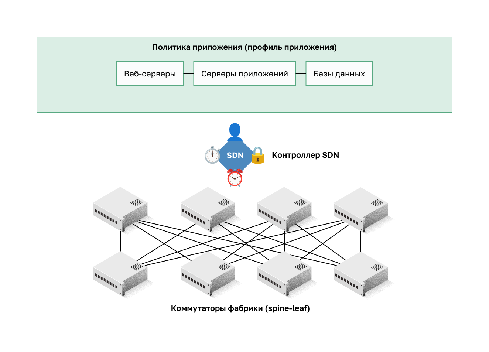
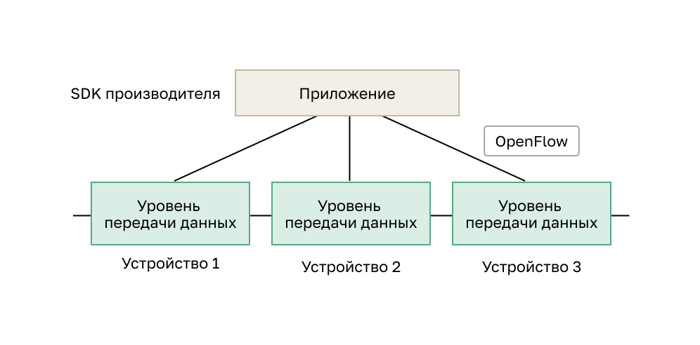
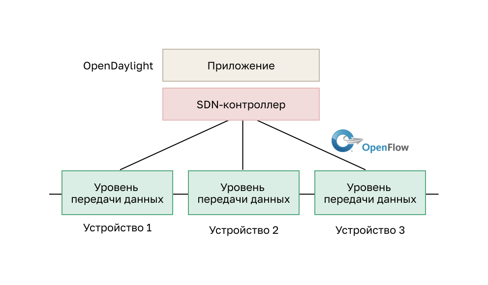
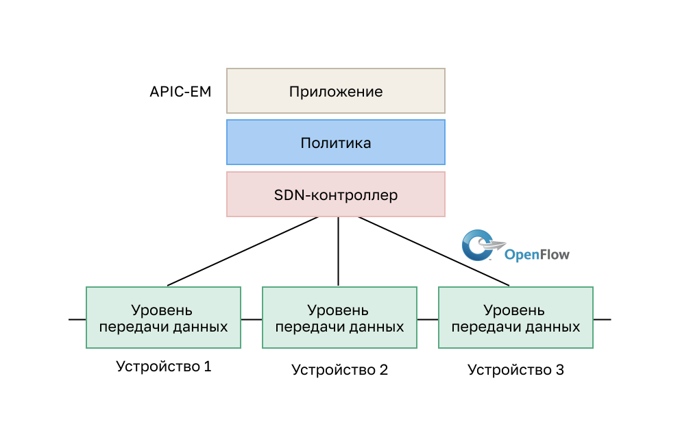

<!-- 13.5.1 -->
## Контроллер и операции SDN

Предыдущая тема охватывала компоненты SDN. В этом разделе подробнее рассмотрим контроллер.

Контроллер SDN — это централизованный уровень управления сети. Он собирает представление о топологии (какие устройства есть в сети и как они соединены), хранит сетевые политики и на их основе программирует уровень передачи данных коммутаторов и маршрутизаторов.

В исходной модели SDN на основе протокола OpenFlow каждый из потоков, проходящих по сети, сначала должен получить разрешение от контроллера, который проверяет, допускают ли такой обмен данными сетевые политики. Если контроллер разрешает поток, он рассчитывает для него маршрут и добавляет запись в каждый коммутатор на пути.

Вся сложная логика сосредоточена в контроллере: он заполняет таблицы потоков, а коммутаторы лишь сверяют с ними пакеты. На рисунке контроллер SDN обменивается данными с коммутаторами OpenFlow по этому протоколу, а сообщения уровня управления защищены TLS. Коммутаторы соединены друг с другом, к ним также подключены оконечные устройства, которые участвуют в потоке пакетов.

<!-- /courses/ensa-dl/ae8eb398-34fd-11eb-ba19-f1886492e0e4/aeb686e2-34fd-11eb-ba19-f1886492e0e4/assets/c71a27d0-1c46-11ea-af56-e368b99e9723.svg -->

<!--
На рисунке контроллер SDN взаимодействует с поддерживающими OpenFlow коммутаторами. У них есть таблицы счетчиков, групп и потоков, которые реализованы в аппаратном обеспечении. У коммутаторов OpenFlow также есть защищенный канал, реализованный программным обеспечением. Контроллер SDN связывается с двумя из них по протоколу OpenFlow по защищенному каналу TLS. Переключатели подключены к трем конечным устройствам.
-->

В каждом коммутаторе есть набор таблиц, реализованных аппаратно или в микропрограмме, для управления потоками пакетов. Поток — это последовательность пакетов, которые соответствуют определенной записи в таблице.

Три типа таблиц:

* **Таблица потоков.**  Сопоставляет входящие пакеты с конкретным потоком и определяет выполняемые над ними действия. Несколько таких таблиц могут работать как конвейер.
* **Таблица групп.**  Задает общий набор действий для одного или нескольких потоков, например рассылку копий пакета через разные порты. На группу ссылаются записи таблицы потоков.
* **Таблица счетчиков (meter table).**  Запускает связанные с производительностью потока действия, включая возможность ограничения скорости трафика.

<!-- 13.5.2 -->
## Северные и южные интерфейсы контроллера

В теме 13.4 говорилось, что контроллер SDN связан с приложениями «северными» API-интерфейсами, а с устройствами — «южными». В терминологии SDN (RFC 7426) контроллер находится посередине: над ним приложения, под ним сетевые устройства.

**Северный интерфейс** (northbound interface) обращен к приложениям: системам оркестрации, сценариям автоматизации, средствам мониторинга. Через него приложение сообщает, что нужно сделать, например разрешить веб-серверам обращаться к базе данных, и получает сведения о топологии и состоянии сети. Обычно это REST API с данными в формате JSON или XML (они рассматриваются в модуле 14), иногда NETCONF или RESTCONF.

**Южный интерфейс** (southbound interface) обращен к коммутаторам и маршрутизаторам. Распространены такие протоколы:

* **OpenFlow**  — напрямую программирует таблицы потоков. Уровень управления при этом целиком находится на контроллере.
* **NETCONF** (RFC 6241) и **RESTCONF** (RFC 8040) — меняют конфигурацию устройства и считывают его состояние, а структуру данных описывают модели YANG. NETCONF передает сообщения XML по SSH, RESTCONF использует методы HTTP.
* **OVSDB** (RFC 7047) — настраивает виртуальные коммутаторы в гипервизорах серверов.

В отличие от OpenFlow, протоколы настройки оставляют устройству собственный уровень управления: коммутаторы и маршрутизаторы сами строят свои таблицы, а контроллер задает их конфигурацию. Благодаря стандартным протоколам южного интерфейса один контроллер может управлять оборудованием разных производителей.

<!-- 13.5.3 -->
## Политики, заданные один раз для всей сети

На деле немногие организации хотят или умеют программировать сеть средствами SDN. Большинству нужно другое: автоматизировать сеть, ускорить развертывание приложений и привести IT-инфраструктуру в соответствие с требованиями бизнеса. Поэтому контроллеры для ЦОД и корпоративных сетей работают с политиками. Политика описывает, что должно происходить в сети, а не то, как настроить каждое устройство.

В ЦОД контроллер обычно управляет фабрикой (fabric) — сетью коммутаторов, которую настраивают и обслуживают целиком, а не по отдельным устройствам. Фабрика ЦОД, управляемая политиками, состоит из трех основных частей:

* **Политика приложения (профиль приложения)**  — группы оконечных устройств, объединенных по роли (например, веб-серверы, серверы приложений и базы данных), и правила взаимодействия между ними: кто к кому может обращаться, какой трафик проверяет межсетевой экран, какое качество обслуживания нужно.
* **Контроллер SDN**  — «мозг» фабрики. Он хранит политики, преобразует их в конфигурацию сети (сегменты, списки контроля доступа, маршруты) и передает ее всем коммутаторам, которых она касается.
* **Коммутаторы фабрики**  — устройства, соединенные по топологии spine-leaf (см. следующий раздел); они исполняют полученную конфигурацию.

Контроллер располагается между политикой приложения и сетевой инфраструктурой. На рисунке он переводит требования приложений в соответствующую им конфигурацию сети.

<!-- /courses/ensa-dl/ae8eb398-34fd-11eb-ba19-f1886492e0e4/aeb686e2-34fd-11eb-ba19-f1886492e0e4/assets/c71b3943-1c46-11ea-af56-e368b99e9723.svg -->

<!--
Контроллер SDN преобразует требования приложений в настройку сети, соответствующую этим требованиям. Вверху находится политика приложения (профиль приложения) с тремя группами: веб-серверы, серверы приложений и базы данных. Ниже нее находится контроллер SDN, а еще ниже — коммутаторы фабрики: четыре коммутатора, каждый из которых связан с четырьмя другими (топология spine-leaf).
-->

Политику задают один раз, а применяется она на десятках и сотнях устройств. Когда виртуальная машина переезжает на другой сервер, контроллер сам передает нужные правила коммутатору на ее новом месте. Развитие этой идеи — сети на основе намерений (IBN, RFC 9315) — рассматривается в модуле 14.

<!-- 13.5.4 -->
## Топология spine-leaf

Коммутаторы фабрики ЦОД обычно соединяют по двухуровневой топологии spine-leaf, как показано на рисунке. Каждый коммутатор нижнего уровня (leaf) соединен со всеми верхними (spine). Между собой коммутаторы уровня leaf никогда не связаны, а верхние подключены только к ним. Поэтому трафик между любыми двумя коммутаторами уровня leaf проходит ровно через один из верхних, и путь между серверами всегда одинаково короток и предсказуем.

Контроллер и все остальные устройства (серверы, системы хранения, межсетевые экраны, маршрутизаторы для выхода во внешние сети) физически подключаются к коммутаторам уровня leaf. Каналы между уровнями leaf и spine обычно маршрутизируемые, поэтому протокол STP не блокирует ни один из них, а распределение нагрузки по равноценным путям (ECMP) задействует их все одновременно. Чтобы добавить порты, расширяют уровень leaf, а чтобы нарастить полосу пропускания — spine.

В отличие от модели OpenFlow из раздела 13.5.1, контроллер фабрики напрямую не управляет уровнем передачи данных. Он централизованно хранит определения политик и программирует коммутаторы уровня leaf, которые пересылают трафик в соответствии с этими правилами.

<!-- /courses/ensa-dl/ae8eb398-34fd-11eb-ba19-f1886492e0e4/aeb686e2-34fd-11eb-ba19-f1886492e0e4/assets/c71bae72-1c46-11ea-af56-e368b99e9723.svg -->

<!--
На рисунке показана двухуровневая топология spine-leaf. Вверху находятся два коммутатора уровня spine. Каналами 40GigE каждый из них соединен со всеми четырьмя коммутаторами уровня leaf. Те, в свою очередь, каналами 10GigE связаны с контроллером SDN и всеми остальными сетевыми устройствами. 
-->

**Базовая и наложенная сети**

Фабрику можно представить в виде двух слоев. **Базовая сеть** (underlay) — физические коммутаторы, каналы и маршрутизация IP. Ее задача — доставлять пакеты между коммутаторами уровня leaf. **Наложенная сеть** (overlay) — логические сегменты, построенные поверх базовой с помощью туннелей. Именно их видят серверы, и к ним применяются политики.

Самая распространенная технология наложенных сетей в ЦОД — VXLAN (RFC 7348). Конечная точка туннеля (VTEP) на коммутаторе уровня leaf или в гипервизоре помещает кадр Ethernet целиком в пакет UDP/IP. Через базовую сеть пакет доходит до такой же точки на стороне получателя, а та извлекает исходный кадр и передает его адресату. Сегменты различают по 24-битному идентификатору VNI. Таких идентификаторов около 16 миллионов, а у VLAN — лишь 4094. Серверы, входящие в один сегмент, работают так, будто находятся в общей локальной сети, даже если подключены к разным коммутаторам уровня leaf. Узнать, за какой конечной точкой находится нужный MAC-адрес, VTEP могут двумя способами. В простейшем случае они изучают адреса из поступающего трафика, а кадры с неизвестным получателем рассылают всем VTEP сегмента (RFC 7348). Чаще же эти сведения распространяет уровень управления — EVPN на основе BGP (RFC 7432, RFC 8365).

<!-- 13.5.5 -->
## Типы SDN

Программируемые сети различаются тем, где работает управляющая логика и на каком уровне абстракции администратор описывает задачу. По этим признакам выделяют три типа SDN.

**SDN на базе устройств**

В этом типе SDN устройства могут программироваться приложениями, работающими на самих устройствах или на сервере в сети, как показано на рисунке. Например, производитель оборудования может предоставлять набор средств разработки (SDK), который позволяет программистам создавать приложения на языках C, Java и Python для интеграции и взаимодействия с его устройствами.

<!-- /courses/ensa-dl/ae8eb398-34fd-11eb-ba19-f1886492e0e4/aeb686e2-34fd-11eb-ba19-f1886492e0e4/assets/c71c4ab2-1c46-11ea-af56-e368b99e9723.svg -->

<!--
На рисунке приведен пример устройства SDN. В верхней части фигуры находится квадрат с надписью «Приложение» с тремя строками вниз до отдельных плоскостей данных. Приложение создано с помощью SDK производителя, а между приложением и плоскостями данных используется OpenFlow.
-->

**SDN на базе контроллера**

Этот тип SDN использует централизованный контроллер, который знает обо всех устройствах в сети, как показано на рисунке. Приложения могут взаимодействовать с контроллером, отвечающим за управление устройствами и обработку потоков трафика в сети. Примеры контроллеров SDN с открытым исходным кодом — OpenDaylight и ONOS.

<!-- /courses/ensa-dl/ae8eb398-34fd-11eb-ba19-f1886492e0e4/aeb686e2-34fd-11eb-ba19-f1886492e0e4/assets/c71cbfe3-1c46-11ea-af56-e368b99e9723.svg -->

<!--
На рисунке приведен пример SDN на основе контроллера. В верхней части рисунка находится квадрат с надписью «Приложение» с контроллером SDN под ним. У контроллера три линии до отдельных плоскостей данных. OpenDaylight используется в качестве контроллера SDN и между ним и плоскостями данных OpenFlow.
-->

**SDN на базе политик**

Этот тип SDN аналогичен SDN на базе контроллера, где централизованный контроллер знает обо всех устройствах в сети, как показано на рисунке. SDN на базе политик включает дополнительный уровень политик, который работает на более высоком уровне абстракции. Он использует встроенные приложения, которые автоматизируют задачи настройки с помощью управляемого рабочего процесса и удобного графического интерфейса пользователя. Навыки программирования не требуются. По этому принципу работают контроллеры фабрик ЦОД, описанные в предыдущих разделах, а также системы управления корпоративными сетями.

<!-- /courses/ensa-dl/ae8eb398-34fd-11eb-ba19-f1886492e0e4/aeb686e2-34fd-11eb-ba19-f1886492e0e4/assets/c71d8330-1c46-11ea-af56-e368b99e9723.svg -->

<!--
На рисунке приведен пример SDN на основе политики. В верхней части рисунка находится квадрат с надписью «Приложение» с политикой между ним и контроллером SDN. От контроллера идут три линии до отдельных плоскостей данных. Это контроллер на базе политик; между контроллером и уровнями передачи данных используется OpenFlow.
-->

<!-- 13.5.6 -->
## Функции контроллера на базе политик

У каждого из типов SDN есть свои особенности и преимущества. SDN на базе политик — наиболее надежный тип, предоставляющий простой механизм контроля и управления политиками во всей сети.

Контроллер на базе политик предоставляет единый интерфейс для управления сетью, включая:

* обнаружение устройств (например, по протоколам LLDP и CDP) и ведение их перечня, а также списка подключенных узлов;
* представление топологии — карту соединений, которую контроллер строит и обновляет сам;
* настройку политик, которые контроллер преобразует в конфигурацию всех нужных устройств;
* трассировку пути между оконечными устройствами.

<!-- 13.5.7 -->
## Трассировка пути

Трассировка пути позволяет администратору наглядно увидеть, как пойдет трафик между двумя оконечными устройствами, и обнаружить конфликтующие, дублированные или теневые записи списков контроля доступа (ACL). Контроллеру известны топология, таблицы пересылки и ACL всех устройств. Поэтому для заданных адресов источника и назначения (при необходимости также протокола и порта) контроллер показывает каждый переход с входным и выходным интерфейсами, а для любого ACL на пути — разрешен ли такой трафик и какая запись (ACE) сработала. Например, если на маршрутизаторе филиала строка, разрешающая весь трафик, стоит выше более строгой записи, последняя никогда не сработает. Увидев такую теневую запись, администратор может поменять строки местами, чтобы лучше фильтровать трафик.

В отличие от команды **traceroute**, трассировка на контроллере строится по собранным сведениям о сети. Поэтому она показывает и коммутаторы уровня 2, и решения ACL, даже если сообщения ICMP на пути отфильтрованы.

<!-- 13.5.8 -->
<!-- quiz -->

