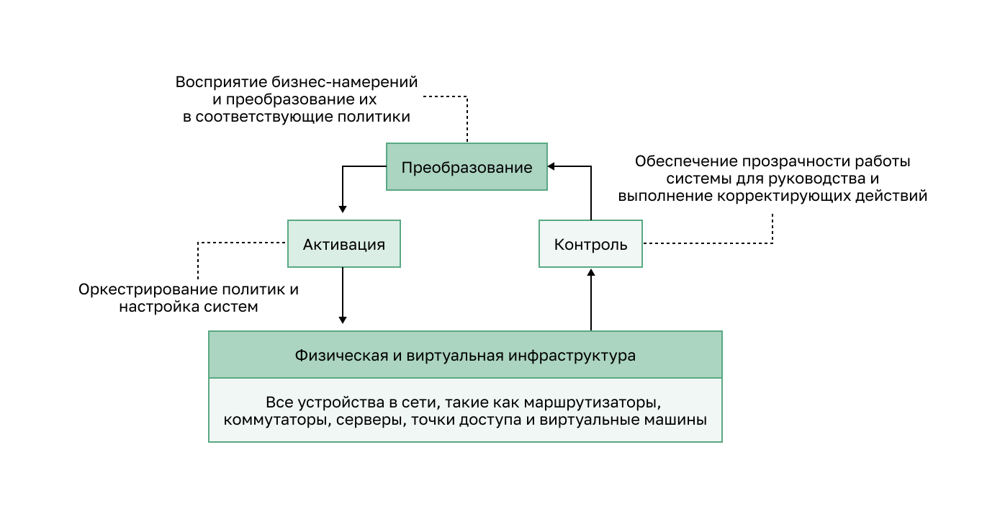

<!-- 14.6.1 -->

<!-- 14.6.2 -->
## Обзор сетей на основе намерений

Сеть на основе намерений (Intent-Based Networking — IBN) — развивающаяся отраслевая модель управления сетевой инфраструктурой следующего поколения. IBN основывается на программно-определяемой сети (Software-Defined Networking — SDN) и переводит проектирование и эксплуатацию с ручного, аппаратно-ориентированного подхода на полностью автоматизированный.

Ключевое понятие IBN — намерение (intent). В документе RFC 9315, подготовленном исследовательской группой IRTF, намерение определено как набор эксплуатационных целей, которым должна отвечать сеть, и результатов, которые от нее ожидаются. Цели описываются декларативно: намерение говорит, **что** нужно получить, но не указывает, **как** этого добиться. Например, «гостевые устройства не должны видеть внутренние серверы» — это намерение, а списки контроля доступа (ACL) на конкретных маршрутизаторах — уже способ его выполнить.

Полезно различать три уровня описания сети:

* **намерение** — бизнес-цель без привязки к устройствам и адресам;
* **политика** — правила, выведенные из намерения: группы пользователей и приложений, их права и приоритеты;
* **конфигурация** — команды и параметры на каждом устройстве, которые реализуют политику.

Система IBN фиксирует бизнес-намерения, преобразует их в политики, единообразно применяет во всей сети и затем с помощью аналитики и машинного обучения непрерывно проверяет результат, подстраиваясь под меняющиеся потребности организации.

В IBN выделяют три основные функции: преобразование, активация и контроль. Они взаимодействуют с физической и виртуальной сетевой инфраструктурой и образуют замкнутый цикл, как показано на рисунке.

<!-- /courses/ensa-dl/ae8eb39a-34fd-11eb-ba19-f1886492e0e4/aeb6adf0-34fd-11eb-ba19-f1886492e0e4/assets/c73c2ec0-1c46-11ea-af56-e368b99e9723.svg -->

* **Преобразование (translation)** — позволяет сетевому администратору выразить ожидаемое поведение сети (в графической консоли или через API) и переводит это намерение в политики, проверяя, что они выполнимы и не противоречат уже действующим.
* **Активация (activation)** — превращает политики в настройки конкретных устройств и развертывает их в физической и виртуальной инфраструктуре с помощью общесетевой автоматизации.
* **Контроль (assurance)** — непрерывно собирает данные о работе сети и проверяет, что намерение выполняется. Если поведение сети отклоняется от намерения, контроль сообщает об этом и запускает корректирующие действия.

<!--
На рисунке показаны три основные функции IBN: преобразование, активация и контроль. На блок-схеме внизу находится Физическая и виртуальная сетевая инфраструктура. Это все устройства в сети: маршрутизаторы, коммутаторы, серверы, точки доступа и виртуальные машины. Из Физической и виртуальной сетевой инфраструктуры направлена стрелка  на Контроль. Контроль обеспечивает непрерывное понимание состояния сети и выполнение корректирующих действий. Еще одна стрелка указывает от Контроля к Преобразованию. Оно фиксирует деловые намерения и переводит их в политики. Еще одна стрелка указывает от Преобразования к Активации. Она активирует политики оркестрации и настраивает системы. Последняя стрелка указывает от Активации до Физической и виртуальной сетевой инфраструктуры.
-->

<!-- 14.6.3 -->
## Сетевая инфраструктура как фабрика

С точки зрения IBN физическая и виртуальная сетевая инфраструктура — это фабрика (fabric): сеть, которой управляют как единым целым, а не как набором отдельных устройств. Фабрика служит фундаментом IBN: в ней активация развертывает политики, а контроль получает из нее данные. Она состоит из двух слоев: базовой и наложенной сети.

Базовая сеть (underlay network) — это физическая топология, которая включает все устройства и каналы, обеспечивающие связность. В центрах обработки данных (ЦОД) ее часто строят по топологии spine-leaf (см. тему 13.5). Конечные точки, такие как серверы на рисунке, подключаются к сети через коммутаторы доступа. Уровень управления базовой сети решает простую задачу: протокол маршрутизации, например OSPF, обеспечивает IP-связность между всеми устройствами фабрики.

**Пример базовой сети (underlay network)**

<!-- /courses/ensa-dl/ae8eb39a-34fd-11eb-ba19-f1886492e0e4/aeb6adf0-34fd-11eb-ba19-f1886492e0e4/assets/c73cf213-1c46-11ea-af56-e368b99e9723.svg -->

<!--
На рисунке показан пример базовой сети. Приведена топология. Сервер соединен с устройством уровня 2 для доступа к конечной точке. Устройство соединено с двумя устройствами маршрутизации уровня 3, связанными между собой. У каждого из них избыточные каналы связи с двумя другими устройствами уровня 2. Остальные коммутаторы уровня 2 связаны с сервером.
-->

Наложенная сеть (overlay network) — это логическая топология, построенная поверх базовой. Граничные устройства фабрики инкапсулируют трафик конечных точек и передают его по туннелям через базовую сеть, а промежуточные устройства видят только внешний IP-заголовок. Чаще всего в фабриках применяют инкапсуляцию VXLAN (RFC 7348): она переносит кадры Ethernet внутри датаграмм UDP и позволяет создать около 16 миллионов логических сегментов вместо 4094 сетей VLAN. Наложенную сеть образуют и другие протоколы инкапсуляции: GRE и IPsec из модуля 8, а также CAPWAP, по которому точки доступа обмениваются трафиком с контроллером WLAN.

Наложенная сеть ограничивает количество устройств, которые должен запрограммировать администратор: новые сегменты и политики задаются только на границе фабрики, а базовая инфраструктура не перенастраивается. Кроме того, она предоставляет услуги и методы пересылки, которые не зависят от физических устройств, например изоляцию групп пользователей и приложений.

Сведения о том, какие конечные точки находятся за каждым граничным устройством, распространяет уровень управления наложенной сети (в фабриках с VXLAN для этого часто используют BGP EVPN, см. тему 13.5). Система IBN позволяет через политики задать, что происходит на этом уровне. Физическое подключение коммутаторов относится к базовой сети, а не к наложенной.

**Пример наложенной сети (overlay network)**

<!-- /courses/ensa-dl/ae8eb39a-34fd-11eb-ba19-f1886492e0e4/aeb6adf0-34fd-11eb-ba19-f1886492e0e4/assets/c73ca3f2-1c46-11ea-af56-e368b99e9723.svg -->

<!--
На рисунке показан пример наложенной сети. Одно устройство доступа уровня 2 для конечных точек слева и еще два справа. Линия идет от устройства уровня 2 слева к устройствам уровня 2 справа. Она изображает протоколы инкапсуляции. Пунктирная двухсторонняя стрелка указывает от устройства уровня 2 слева к устройствам уровня 2 справа. Стрелка изображает уровень управления наложенной сети. 
-->

<!-- 14.6.4 -->
## Замкнутый цикл IBN

Рассмотрим, как функции IBN работают вместе, на примере намерения «гостевые устройства получают доступ только в Интернет».

1. **Выражение намерения.** Администратор в графической консоли или запросом к API описывает цель в понятиях бизнеса — группами пользователей и приложений, а не IP-адресами и интерфейсами.
2. **Преобразование.** Система определяет группу «Гости», запрещает ей обращаться к внутренним сегментам и разрешает выход в Интернет. Новую политику она сверяет с уже действующими, чтобы найти конфликты до того, как изменения попадут на устройства.
3. **Активация.** Система формирует конфигурацию для каждого затронутого устройства — сегмент наложенной сети, списки контроля доступа, параметры качества обслуживания (QoS) — и автоматически развертывает ее. Это та же оркестрация, что и в теме 14.5.
4. **Контроль.** Устройства постоянно передают телеметрию, и система сравнивает фактическое состояние сети с намерением. Если, например, после замены коммутатора гостевой сегмент снова получил доступ к внутренним серверам, система обнаружит отклонение и либо сама восстановит нужную конфигурацию, либо предложит исправление администратору.

Результаты контроля возвращаются к преобразованию, поэтому IBN называют системой с замкнутым циклом (closed loop): намерение не превращается в команды один раз, а поддерживается все время, пока действует.

RFC 9315 делит функции IBN на две группы: выполнение намерения (intent fulfillment) — прием, преобразование и оркестрация — и обеспечение соответствия (intent assurance) — мониторинг, проверка и корректирующие действия. Постепенный уход сети от заданной цели, например из-за накопления мелких ручных изменений, там же назван дрейфом намерения (intent drift). Обнаружить и устранить его — одна из задач контроля.

Контроль опирается на телеметрию, общую архитектуру которой описывает RFC 9232. Вместо периодического опроса по SNMP (см. модуль 10) современные устройства сами передают данные потоком — с заданным интервалом или при каждом изменении. Такую передачу называют потоковой телеметрией (streaming telemetry). Аналитика запоминает обычное поведение сети, выявляет аномалии и с помощью машинного обучения прогнозирует проблемы до того, как с ними столкнутся пользователи. Именно здесь искусственный интеллект помогает управлять сетью.

Основные области применения IBN перечислены в таблице.

| **Область** | **Что выражает намерение** | **Что делает система IBN** |
| --- | --- | --- |
| **Доступ и сегментация в кампусе** | Кто и к каким ресурсам может обращаться, где бы ни подключился пользователь | Распознает пользователя или устройство при подключении, помещает его в логическую группу и применяет соответствующую политику как в проводном, так и в беспроводном сегменте |
| **Программно-определяемая глобальная сеть (SD-WAN)** | Требования приложений к каналам: задержка, потери пакетов, стоимость | Централизованно управляет разнородными подключениями филиалов (MPLS, Интернет, сотовая связь) и для каждого приложения выбирает канал, который сейчас отвечает его требованиям |
| **Контроль работы сети** | Ожидаемое качество сети и приложений | Сравнивает телеметрию с обычным поведением сети, находит первопричины неполадок и прогнозирует проблемы. Трассирует путь между двумя узлами и показывает, какие ACL на нем пропускают трафик, а какие блокируют (см. тему 13.5) |
| **Безопасность** | Какие потоки трафика допустимы | Использует сеть как датчик: выявляет подозрительное поведение и изолирует зараженное устройство в карантинной группе |

Эти области не исключают друг друга: организация может применять IBN во всех четырех сразу.

<!-- 14.6.5 -->
## Контроллер IBN и его API

Центр системы IBN — контроллер: программная платформа на сервере, в виртуальной машине или в облаке, которая объединяет функции преобразования, активации и контроля. Как и контроллер SDN из модуля 13, он централизованно управляет множеством устройств и хранит общую картину топологии и определения политик, но работает на более высоком уровне абстракции: администратор задает ему не правила пересылки, а намерения.

Обычно контроллер объединяет несколько функциональных блоков: проектирование (модель сети: площадки, устройства, каналы, адресные пулы и шаблоны), политики, развертывание (provisioning) оборудования и конфигураций, контроль (assurance) и интеграцию с другими системами.

Контроллер взаимодействует с окружением через два вида программных интерфейсов (API, см. тему 14.3), которые уже встречались в теме о SDN (13.4):

* **Северный интерфейс** (northbound API) обращен к приложениям и людям. Обычно это REST API поверх HTTPS с данными в формате JSON, а его операции соответствуют методам HTTP из темы 14.4: например, запрос GET возвращает список устройств, а POST создает новую политику.
* **Южный интерфейс** (southbound API) обращен к сетевым устройствам: через него контроллер считывает их состояние и передает конфигурацию. Для этого применяют протоколы NETCONF (RFC 6241) и RESTCONF (RFC 8040), которые передают данные, описанные моделями YANG: NETCONF кодирует их в XML, RESTCONF — в XML или JSON (см. тему 14.4). Устройства без поддержки этих протоколов контроллер настраивает через командную строку по SSH и опрашивает по SNMP. В обратном направлении идут потоки телеметрии. В фабриках ЦОД южным интерфейсом может служить и OpenFlow.

Инструменты управления конфигурацией из темы 14.5 и контроллер IBN дополняют друг друга. Сборник сценариев или манифест описывает желаемое состояние устройств, а контроллер IBN принимает намерение для всей сети, сам выводит из него конфигурации и затем постоянно проверяет, что результат совпадает с задуманным. Инструменты управления конфигурацией могут служить механизмом активации внутри системы IBN или обращаться к контроллеру через его северный REST API.

Похожие средства есть и в контроллерах SDN с открытым исходным кодом, например подсистема Intent Framework в ONOS.

<!-- 14.6.6 -->

<!-- 14.6.7 -->

<!-- 14.6.8 -->

<!-- 14.6.9 -->

<!-- 14.6.10 -->
<!-- quiz -->

